A 3D vector map for the web. Stylized buildings, drifting volumetric clouds, raymarched lighting. Reads PMTiles vector archives, renders with three.js. Drops into a single `<div>` with one function call.

**[Live demo →](https://cottagehop.github.io/HereBeDragons/)** &nbsp;·&nbsp; [with Studio](https://cottagehop.github.io/HereBeDragons/?studio=1) &nbsp;·&nbsp; [real-estate investor view](https://cottagehop.github.io/HereBeDragons/?theme=professional&investor=1) &nbsp;·&nbsp; [with demo polygons](https://cottagehop.github.io/HereBeDragons/?polygons=1)

```
npm install github:cottagehop/HereBeDragons three
```

Installed straight from GitHub: npm builds the library on install (via the `prepare` script), so you get `dist/` with bundled JS and type declarations. The package name stays `@cottagehop/here-be-dragons`, so imports are unchanged. Pin a specific release with `github:cottagehop/HereBeDragons#v0.1.0`.

`three` is a peer dependency install it explicitly so your bundler dedupes it with anything else that uses three.

---

## 30-second quickstart

```html
<!doctype html>
<html>
  <body>
    <div id="app" style="position: fixed; inset: 0;"></div>
    <script type="module">
      import { createHereBeDragons } from '@cottagehop/here-be-dragons';

      const map = await createHereBeDragons(document.getElementById('app'), {
        center: { lat: 40.7065, lon: -74.009 },
        zoom: 15,
        pmtiles_url: 'https://your-tiles.example.com/tiles.pmtiles'
      });
    </script>
  </body>
</html>
```

That's it. You get a 3D map with stylized buildings, roads, water, and labels. The map sizes to fill its container give that container a width and height (the `position: fixed; inset: 0;` snippet above is the simplest "fill the page" recipe).

---

## Use it without writing code (Studio → JSON → embed)

The fastest workflow:

1. Open the demo with `?studio=1` (or call `createMapStudio(map, ...)` in your code).
2. Pick a theme, drag the camera sliders, tweak colors, toggle layers everything is live.
3. Click **Export JSON**. The browser downloads `here-be-dragons.config.json`. (Click **Import JSON** to load a saved config back into the panel and keep iterating.)
4. On your real site, fetch that JSON and pass it straight to `createHereBeDragons`:

```js
import { createHereBeDragons } from '@cottagehop/here-be-dragons';

const config = await fetch('/map-config.json').then((r) => r.json());
await createHereBeDragons(document.getElementById('app'), config);
```

The exported JSON is a literal `HereBeDragonsOptions` value `theme`, `customColors`, `clouds`, `compass`, layer toggles, camera position, all of it. `createHereBeDragons` applies the declarative fields automatically. **No imperative `applyTheme` / `setCloudsOpacity` / etc. calls are needed.**

The same goes for the **3D Satellite (splats)** overlay: paste a `{z}/{x}/{y}.spz` tile URL into the Studio's splats section (the overlay is created on the spot — no `splats` option or reload needed), tune the budget / rounded union / reveal, and the export carries a `splats` block that `createHereBeDragons` turns back into the same overlay — including how a plain `map.setSplatsEnabled(on)` transitions (`splats.reveal`).

---

## Options reference (`HereBeDragonsOptions`)

Only three fields are required (`center`, `zoom`, `pmtiles_url`); everything else has a sensible default. The table is grouped so you can jump to the part you care about.

**Required**

| Field | Type | Default | Description |
|---|---|---|---|
| `center` | `{ lat, lon }` | required | Initial geographic center. |
| `zoom` | `number` | required | Initial zoom (sane range 4–20). |
| `pmtiles_url` | `string` | required | PMTiles archive URL (or local path). See [Hosting your tiles](#hosting-your-tiles). |

**Camera**

| Field | Type | Default | Description |
|---|---|---|---|
| `tilt` | `number` | `55` | Camera pitch in degrees (0 = top-down). |
| `bearing` | `number` | `0` | Camera rotation from north, +CW. |
| `tiltRange` | `{ min, max }` | `0–75°` | Clamp the allowed tilt range. Initial value still comes from `tilt`. |
| `bearingRange` | `{ min, max }` | full 360° | Clamp the allowed bearing range. Initial value still comes from `bearing`. |
| `zoomRange` | `{ min, max }` | `~4–22` | Clamp the allowed zoom range. Initial value still comes from `zoom`. |
| `bounds` | `BoundingBox` | `undefined` | Geographic box that clamps camera panning. Use `COMMON_BOUNDS` for presets. |
| `useUserLocation` | `boolean` | `false` | Request `navigator.geolocation` and fly there on resolve. |

**Theme & color**

| Field | Type | Default | Description |
|---|---|---|---|
| `theme` | `ThemeName \| string` | `undefined` | Apply a named theme on load. Autocompletes the built-ins. |
| `customColors` | `Partial<ThemeColors>` | `undefined` | Per-color overrides on top of the theme. |
| `background` | `string` | theme sky | Canvas background color. |

**Atmosphere & painterly effects** (each overrides the active theme's value)

| Field | Type | Default | Description |
|---|---|---|---|
| `clouds` | `boolean \| { enabled?, opacity? }` | `false` | Volumetric cloud pass on/off + opacity. Off by default (the raymarch is the heaviest per-frame GPU cost). |
| `cloudPreset` | `CloudPreset` | theme | Cloud look: coverage, density, altitude band, noise scale, wind speed, cloud + shadow colors. Separate from `clouds` on/off. |
| `lightPreset` | `LightPreset` | theme | Lighting look: sun color/intensity, fill, ambient, hemisphere sky/ground/intensity. |
| `fog` | `{ tiltStart?, tiltEnd?, strength? }` | theme | Atmospheric fog that ramps in as the camera tilts toward the horizon (`tiltStart`→`tiltEnd` degrees, scaled by `strength`). |
| `surfacePainterly` | `number` (0..1) | theme | Watercolor wash on flat surfaces (ground, water, landuse, beach). |
| `paperGrain` | `number` (0..1) | theme | Screen-space paper grain folded into the final pass. |
| `roadTexture` | `number` (0..1) | theme | Procedural road surfacing: cobblestone setts on roads, mottled earth on paths. |
| `spores` | `boolean` | theme | Drifting pollen motes in the air. |
| `pitchedRoofs` | `boolean` | theme | Peaked roofs on low/mid-rise buildings instead of flat caps. Only the Ghibli theme enables it by default. |
| `buildingStyle` | `ThemeBuildingStyle` | theme | Painterly building treatment: plaster walls, glowing windows, tiled roofs, per-building variety. |
| `outline` | `OutlineConfig` | theme | Illustrated outline/ink look + saturation: edge `strength`/`darkness`, comic `halftone`/`hatching`, `saturation`. |
| `windStrength` | `number` | `1` | Wind-sway multiplier for the grass + tree billboards (0 = still). |

**Layers, overlays & markers**

| Field | Type | Default | Description |
|---|---|---|---|
| `layers` | `Partial<Record<LayerName, boolean>>` | most on | Per-layer enable/disable. See [Layers](#layers). |
| `tags` | `TagsConfig` | `{}` | Tag overlay configuration (clustering, default styles). See [Tags](#tags-interactive-markers). |
| `buildings` | `BuildingPopupConfig` | `{}` | Building picker + popup settings. See [Buildings](#buildings). |
| `parcels` | `ParcelsConfig` | `undefined` | Load county parcel-boundary polygons from a **second** PMTiles archive and render them as clickable outlines above the basemap. |
| `splats` | `SplatsConfig` | `undefined` | Stream pre-tiled **3D Gaussian splats** (`{z}/{x}/{y}.spz` / `.ply`) over the basemap, drawn with the optional `@sparkjsdev/spark` peer dependency. Residency is capped by a splat budget (`maxSplats`; a smaller `lowTierMaxSplats` on the `'mobile'` / `'low'` tiers). Every option is also settable at runtime with `map.setSplatsOptions()` — including the first `urlTemplate` on a map built without `splats` — and editable in the Studio. See [Splats](#splats). |
| `compass` | `boolean` | `true` | Show the compass overlay. Click to reset bearing. |
| `scaleBar` | `boolean \| { units?, targetWidthPx? }` | `true` | Scale-bar overlay. Click toggles units (defaults to imperial). `false` to hide. See [Scale bar](#scale-bar). |
| `signsDensity` | `number` (0..1) | `0.5` | Shop-sign banner density. Needs the `signs` layer enabled. |
| `signsMinZoom` | `number` | `15` | Camera zoom at/above which shop-sign banners appear. |
| `labelHeight` | `number` (m) | `0` | Lift place-name labels above the skyline at tilted views (0 pins them to the actual coords). |

**Performance & quality** (see [Performance tuning](#performance-tuning))

| Field | Type | Default | Description |
|---|---|---|---|
| `quality` | `'low' \| 'mobile' \| 'high' \| 'auto'` | `'auto'` | Render-quality tier. `'auto'` serves `'mobile'` to phones/tablets, detects the GPU on desktop, and downgrades integrated graphics to `'low'`. |
| `pixelRatio` | `number` | quality-capped `devicePixelRatio` | Override render resolution. Always wins over the `quality` tier's cap. |
| `msaa` | `number` | tier (4 high / 0 low) | MSAA sample count on the color/normal targets. 0 = FXAA-only. Fixed at construction. |
| `dynamicResolution` | `boolean` | `false` | Render internally at a cheaper resolution while the camera moves (the canvas itself never resizes; the final pass upscales), back to full resolution at rest (dissolved in over `performance.settleFadeMs`). Off by default so the map never softens in motion; enable to buy frame rate on fill-rate-bound devices. No effect on 1× displays or when `pixelRatio` is pinned. |
| `interactionTilePriority` | `boolean` | `false` | Prioritize scroll/zoom smoothness over tile loading: suspend tile-mesh construction (and its synchronous GPU upload) while a gesture is live, then burst-build the backlog the instant motion settles. Off by default so fresh detail streams in mid-pan/zoom; enable for maximally glass-smooth gestures at the cost of tiles appearing a beat after you stop. |
| `lowResUnderlay` | `boolean \| { enabled?, zoom? }` | `true` (z11) | Low-zoom underlay beneath the z14 plane so the screen is never blank while tiles stream in. `false` to disable. |
| `tileSpawnDurationMs` | `number` | `3000` | Duration of the load animation: with `tileReveal` on (default), how long late-arriving buildings take to grow out of the ground; with it off (or `tileReveal.rise`), the per-tile "rise from below ground". 0 = snap in instantly. |
| `tileReveal` | `boolean \| { growMs?, feather?, rise? }` | `true` | Newly loaded basemap tiles appear as a growing **rounded union** (one tile = circle, two = pill, 2×2 = rounded square) instead of whole squares popping in — see [Tile reveal](#tile-reveal). `growMs` 700, `feather` 0.03 (tile units), `rise` false. `false` = the old square tiles + slab rise. Runtime: `map.setTileReveal(boolean \| { growMs?, feather?, rise? })`. |
| `tiltShift` | `boolean \| { radius?, band?, falloff?, saturation?, contrast?, vignette? }` | `false` | Tilt-shift "miniature" look: a sharp band across the point the camera looks at, blur growing above and below it, and a saturated model-photography grade — towns read as scale models. Eased on/off, free while off, `'high'` tier only. Runtime: `setTiltShift()`. 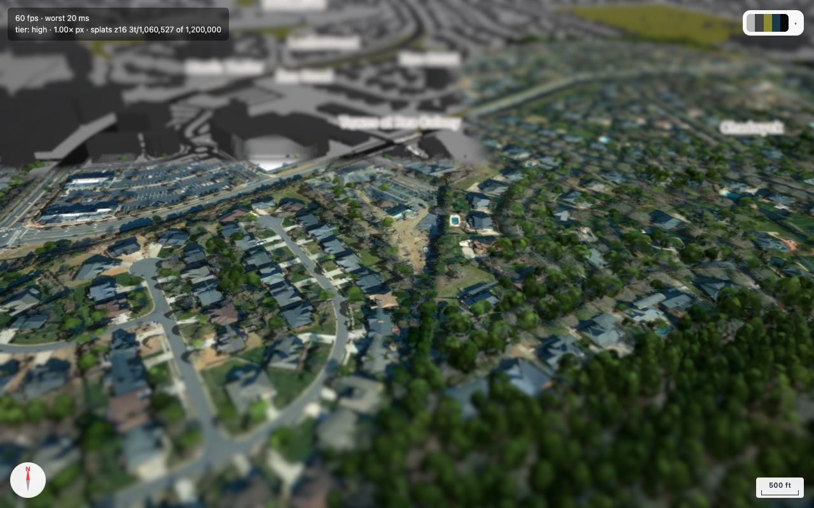 |
| `performance` | `{ workerPoolSize?, visibleRadius?, tileWindowRadius?, tileWindowRadiusFar?, maxTileApplyMsPerFrame?, dispatchInterval?, frameBudgetMs?, autoUpgradeFrameMs?, autoDowngradeFrameMs?, autoMotionResFrameMs?, framePacing?, settleFadeMs? }` | auto | Tile-pipeline + auto-tier tuning. `autoMotionResFrameMs` (default `25`): under `quality: 'auto'`, a HiDPI display whose plain-map moving frames stay slower than this renders its MOVING frames at 1× from then on (the picture at rest keeps the full ratio) — the gentle step before `autoDowngradeFrameMs` drops to the flat `'low'` tier; Safari redacts the GPU name, so this is what catches an Intel Mac. `settleFadeMs` (default `400`, `0` = snap): when the picture sharpens at rest (full resolution back, the splats' motion LoD swapped for full detail) the last moving frame is held and cross-fades into the sharp one instead of popping. `reprojection` (default `true`): a tick held back by GPU pacing or the splats' swap hold presents the last frame warped to the current camera (ground-plane reprojection) so every vsync shows the motion. |

### Layers

`LayerName` values: `'buildings'`, `'roads'`, `'rails'`, `'water'`, `'waterways'`, `'landuse'`, `'labels'`, `'trees'`, `'grass'`, `'waves'`, `'signs'`, `'cars'`. The base layers default to enabled; `'trees'`, `'grass'`, `'waves'`, `'signs'`, and `'cars'` are opt-in.

```js
layers: {
  buildings: true,
  roads: true,
  rails: false,        // hide subway lines
  cars: true,          // opt into animated traffic
  trees: true,         // billboard trees (sway in the wind)
  grass: true,         // wind-blown grass tufts over parks
  waves: true,         // animated foam along the shoreline
  signs: true,         // sparse Japanese shop-sign banners
}
```

### Themes

Built-in `ThemeName` values: `'ghibli'`, `'professional'`, `'cottagecore'`, `'cottagecoredark'`, `'cyberpunk'`, `'modern'`, `'greyscale'`, `'greyscaledark'`, `'dark'`, `'eighties'`, `'seventies'`, `'oldworld'`, `'middleearth'`, `'concretejungle'`, `'comic'`.

Two are worth calling out:

- **`ghibli`** the showcase stylized look (painterly walls, tiled roofs, kawara texture, wind-blown grass, drifting pollen, lit shopfronts). Toggle every effect individually via the runtime setters above.
- **`professional`** a clean, neutral preset for client-facing **real-estate maps**: soft grey buildings, calm blue water, restrained outlines, a strong professional-blue building/floor highlight tuned for picking out listings and comps. Every Ghibli FX is deliberately off, so the map reads as a polished business product.

```js
import { createHereBeDragons, THEMES } from '@cottagehop/here-be-dragons';

// As an option:
await createHereBeDragons(el, {
  center, zoom, pmtiles_url,
  theme: 'concretejungle',
  customColors: { building: '#222', water: '#0a2030' }
});

// At runtime:
map.applyTheme('comic');
map.setCustomColors({ road: '#000' });

// Register your own theme:
THEMES.myCustom = { land: '#fff', building: '#333', park: '#7cc', water: '#08f', road: '#222' };
map.applyTheme('myCustom');
```

A `ThemeColors` object has five required keys (`land`, `building`, `park`, `water`, `road`) plus optional `beach`, `sky`, `highlight`, `outline`, `saturation`.

---

## Instance API (`HereBeDragons`)

### View

```ts
map.setView(lat, lon, zoom?)
map.setBearing(deg)
map.setTilt(deg)
map.getView()                   // { lat, lon, zoom, tilt, bearing }
await map.flyTo({ lat, lon, zoom?, tilt?, bearing?, durationMs? })
await map.resetView(durationMs?)

// Clamp how far the user can drag past the initial value.
// Pass null to release a clamp.
map.setTiltRange({ min: 20, max: 50 })
map.setBearingRange({ min: -45, max: 45 })
map.setZoomRange({ min: 12, max: 18 })
```

### Layers + appearance

```ts
map.setLayerEnabled('roads', false)
map.getLayerEnabled('cars')
map.applyTheme('concretejungle')
map.setCustomColors({ water: '#1a3a4a' })
map.getCurrentTheme()
map.getCustomColors()
map.setBuildingsFlat(true)      // collapse extrusions to footprints
map.setCloudsEnabled(false)
map.setCloudsOpacity(0.6)
```

### Ghibli atmosphere + painterly FX

Every stylized feature is runtime-configurable (and round-trips through the Studio export). Each is seeded by the active theme and individually overridable.

```ts
// Painterly surface FX (all 0..1)
map.setSurfacePainterly(0.9)    // watercolor wash on ground/water/landuse
map.setPaperGrain(0.8)          // screen-space paper grain
map.setRoadTexture(1)           // cobblestone roads + dirt paths
map.setSporesEnabled(true)      // drifting pollen motes
map.setPitchedRoofsEnabled(true) // peaked roofs on low/mid-rise buildings

// Painterly buildings (null clears it back to flat toon buildings)
map.setBuildingStyle({ strength: 1, roof: '#b5573c', window: '#ffdc8c', floorHeight: 3.6 })
map.getBuildingStyle()          // resolved { strength, roof, window, floorHeight }

// Cloud look (separate from the on/off + opacity above)
map.setCloudPreset({ coverage: 0.42, densityScale: 4.6, altitudeMin: 650, altitudeMax: 1600,
                     cloudColor: '#fff6e6', shadowColor: '#b9c6dc' })

// Lighting rig
map.setLightPreset({ sun: '#fff0cf', sunIntensity: 1.08, hemiSky: '#bfe2f6', hemiIntensity: 0.34 })

// Wind + signs
map.setWindStrength(1.5)        // grass + tree sway (0 = still)
map.setSignsDensity(0.5)        // shop-sign banner density 0..1
map.setSignsMinZoom(15)         // zoom at/above which banners appear

// Outline / ink look + saturation (only the provided fields change)
map.setOutline({ strength: 0.85, darkness: 0.72, saturation: 1.75 })
map.getOutline()                // resolved { strength, darkness, halftone, hatching, saturation, ... }
```

`setBuildingStyle`/`setCloudPreset`/`setLightPreset` accept `null` to reset to the neutral default. Each setter has a matching getter that reads back the resolved live values (from the shader uniforms / lights), so the Studio can stay in sync.

### Tags (interactive markers)

```ts
const tag = map.addTag({
  id: 'home',
  lat: 40.7065, lon: -74.009,
  icon: '🏠',
  text: '$1.2M',
  badge: '3 BR',
  color: '#10b981',
  modal: { title: 'Trinity Church Condo', body: '<p>South-facing 3 BR…</p>' },
  onClick: (handle, evt) => { console.log('clicked', handle.id); }
});

tag.setText('$1.4M');
tag.setColor('#f59e0b');
tag.open();         // open the modal programmatically
tag.close();
tag.remove();

map.removeTag('home');
map.clearTags();
```

Tags within `mergeDistancePx` of each other automatically collapse into a count cluster; clicking the cluster zooms toward its centroid.

#### Real-estate listing presets

For client-facing real-estate maps, `REAL_ESTATE_TAG_PRESETS` is an opinionated set of color + icon + badge defaults for the common listing states (`forSale`, `pending`, `sold`, `newListing`, `openHouse`, `comp`, `subject`). Spread one into your `addTag` call to get a polished, consistent marker with one line:

```js
import { createHereBeDragons, REAL_ESTATE_TAG_PRESETS as RE } from '@cottagehop/here-be-dragons';

map.addTag({ id: 'l1', lat, lon, text: '$1.2M', ...RE.forSale });
map.addTag({ id: 'l2', lat, lon, text: '$980K',  ...RE.sold });
map.addTag({ id: 'subject', lat: subLat, lon: subLon, text: 'Subject', ...RE.subject });
```

The colors are tuned to read cleanly over the `professional` theme but stay legible on every built-in palette. The preset map is frozen, so it's safe to share across instances.

### Polygons (custom filled regions)

```ts
const poly = map.addPolygon({
  id: 'demo-zone',
  color: '#22c55e',
  opacity: 0.4,
  points: [
    { lat: 40.7070, lon: -74.0120 },
    { lat: 40.7080, lon: -74.0080 },
    { lat: 40.7060, lon: -74.0060 }
  ]
});
map.removePolygon('demo-zone');
```

#### Comp-radius helper

`makeRadiusPolygon(lat, lon, radiusMeters, segments?)` returns an array of `PolygonPoint` approximating a geodesic circle (spherical destination-point formula, sub-metre accurate at city scale). Drop it straight into `addPolygon` to visualise a comparables radius, walkability buffer, service area, or flood-plain rim:

```ts
import { makeRadiusPolygon } from '@cottagehop/here-be-dragons';

map.addPolygon({
  id: 'comp-radius',
  color: '#3b82f6',
  opacity: 0.20,
  points: makeRadiusPolygon(subject.lat, subject.lon, 800)  // 800 m around the subject
});
```

### Buildings

```ts
map.onBuildingClick((info) => {
  console.log(info.id, info.height, info.properties);
});
const info = map.selectBuilding('osm:way/12345', /*floor*/ 12);
map.clearBuildingSelection();
map.setBuildingPopup({ popupEnabled: false });   // disable the auto popup
map.setBuildingHighlightColors('#ffe600', '#7ec8ff');
const all = map.getLoadedBuildings();            // BuildingInfo[]
```

The canvas cursor swaps from `grab` to `pointer` the moment a user hovers a building, signalling clickability for the property-shopping UX. The hovered building itself also gets a subtle warm brighten, so users can see exactly which one is under the cursor. The hover raycast is RAF-throttled internally so a fast-moving pointer can't burn dozens of raycasts per second, and the highlight only triggers a redraw when the hovered building actually changes, so a pointer drifting across a single building costs nothing.

### Splats

An optional overlay that streams pre-tiled **3D Gaussian splats** and draws them on top of the vector basemap with [Spark](https://sparkjs.dev) (`@sparkjsdev/spark`, an optional peer dependency — install it yourself; the map `import()`s it lazily the first time a `splats` option is present and never otherwise). Tiles are the `.spz` / `.ply` files SplatMap's tiler writes — a **tile pyramid** (z16 full detail, z15 … z13 merged and thinned, see *Tile pyramid* below) — each in the tile-local frame **of its own zoom** (origin at the tile's south-west corner, x east, y north, z up, Web-Mercator metres). The map places each tile at its SW corner, rotates z-up onto Y-up, and scales by `cos(originLat)` so the splats land on the vector streets to the centimetre.

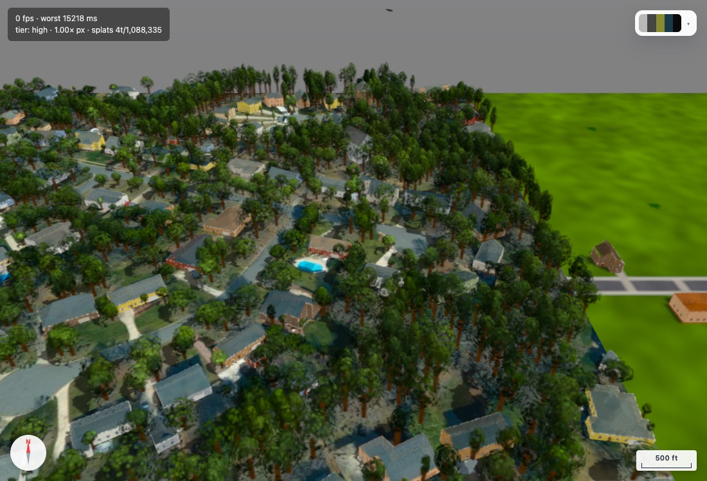

```ts
const map = await createHereBeDragons(el, {
  ...opts,
  splats: { urlTemplate: 'https://tiles.example.com/splats/{z}/{x}/{y}.spz', minTileZoom: 13, maxTileZoom: 16 }
});
map.setSplatsEnabled(false);                                  // instant toggle (remembered across tier swaps)
map.setSplatsEnabled(true, { reveal: 'ripple' });             // …or ripple them in from the view centre
map.setSplatsEnabled(false, { reveal: 'ripple', durationMs: 1200 }); // ripple out, then unload
const { tiles, tileZoom, splats, maxSplats, reveal, basemapCovered, governor } = map.getSplatsStats(); // tileZoom = active pyramid level
// governor = { enabled, frameMs, targetFrameMs, scale, maxScale, biasDrop, splatMaxDistance, thinKeep } — what the frame-time governor measures and holds

// Retune at runtime — applied live, or by rebuilding / creating the layer when it must:
map.setSplatsOptions({ maxSplats: 600_000, roundedUnion: { feather: 0.06 } }); // live
map.setSplatsOptions({ reveal: { reveal: 'ripple', durationMs: 1200 } });      // default for a plain toggle…
map.setSplatsEnabled(true);                                                    // …which now ripples in
map.setSplatsOptions({ urlTemplate: 'https://tiles.example.com/v2/{z}/{x}/{y}.spz' }); // rebuild from the new tiles
map.getSplatsOptions(); // everything in effect, defaults filled in (urlTemplate: '' = no overlay)
```

`SplatsConfig`:

| Option | Type | Default | Runtime (`setSplatsOptions`) | Description |
|---|---|---|---|---|
| `urlTemplate` | `string` | — (required) | rebuild · creates the overlay if there was none · `''` removes it | `{z}/{x}/{y}.spz` / `.ply` tile template. Its presence is what turns the overlay on. |
| `imageryTemplate` | `string \| null` | `urlTemplate` with `.png` | rebuild | Satellite ground imagery (see below); `null` skips it. | When derived (not set), the layer tries `{y}.webp` first, then `{y}.png`; on the high tier with a high-DPI screen the finest level tries `{y}@2x.webp` (2048 px) first.
| `enabled` | `boolean` | `true` | live (same as `setSplatsEnabled(on)`) | Master switch; `false` builds the machinery but keeps it idle. |
| `minZoom` | `number` | `13` | live | Camera zoom below which nothing loads and resident tiles are dropped. |
| `minTileZoom` / `maxTileZoom` | `number` | `13` / `16` | live (the active level is re-evaluated — a level transition, not a rebuild) | Coarsest / finest level of the tile pyramid. The requested `{z}` is `clamp(floor(cameraZoom + lodBias), minTileZoom, maxTileZoom)` with ±0.15 hysteresis. |
| `lodBias` | `number` | `1.5` | live | Added to the camera zoom before the level is picked: `-1` = one level coarser everywhere, `+1` finer; fractions move the switch-over points. The default runs **one level finer than the camera zoom and switches half a zoom early** — a smaller, sharper satellite patch where the camera looks, with the vector map (`hideBasemap: 'covered'`) carrying the rest of the view. The `governor` may lower the bias in effect by up to 1. |
| `levelSelection` | `'bias' \| 'resolution'` | `'bias'` | live | How the pyramid level is chosen. `'bias'` keys off camera zoom. `'resolution'` picks the coarsest level whose imagery still out-resolves the screen by `resolutionMargin` — measured at camera zoom 14.6 that is 29x more satellite coverage for half the splats, with an identical picture (and identical level at the zoom cap). `lodBias` does not apply in resolution mode. |
| `resolutionMargin` | `number` | `0.5` | live | `'resolution'` only: how much finer than the screen a level's imagery must be (1 = matched, 0.5 = 2x oversampled). Halve it for one level finer; raise it for wider coverage. |
| `resolutionTiltAware` | `boolean` | `true` | live | `'resolution'` only: judge the level from the near edge of a tilted view rather than the camera target, keeping the foreground crisp when pitched over. Softened so it only shifts the level near a threshold or at high tilt. |
| `lowTierLodBias` | `number` | `0.5` | live | `lodBias` on the `'low'` / `'mobile'` tiers — one level coarser than the `'high'` default. |
| `levelFadeMs` | `number` | `350` | live | Length of the cross-dissolve when the pyramid level changes. A tile landing over ground that a resident tile of ANOTHER level already covers appears at its full rounded-union shape and dissolves in (opacity, with splat scale easing from 0.6) while the tile(s) it replaces dissolve out; reversing mid-way continues from where it got to. New ground at the edge of the map still uses the grow animation. `0` = instant swap. |
| `transitionOvershoot` | `number` | `0.35` | live | How far a dissolve may run over the splat budget, as a fraction of `maxSplats` (capped at the incoming tile's size), for at most `levelFadeMs + 250` ms — so the outgoing level fades instead of being evicted on the spot. The frame governor ignores those frames. |
| `prefetchBand` | `number` | `0.2` | live | When the camera zoom is within this distance of a level boundary, the next level's tile under the camera target is fetched and decoded in the background (not attached), so the dissolve can start the moment the boundary is crossed. `0` disables prefetch. |
| `maxCameraZoom` | `number` | `15` | live | Camera **max zoom while the overlay is on** (up close surfels read as blobs). A camera already closer is eased out over 600 ms; the map's previous limit (`zoomRange` included) returns when the overlay is disabled. |
| `maxCameraTilt` | `number` | `45` | live | Camera tilt cap (degrees from straight down) while the overlay is on, laid over the map's own tilt range the way `maxCameraZoom` is laid over its zoom range: a steeper camera is eased up to it (600 ms), and the range is put back when the overlay goes. Seen from steeper angles the satellite layer runs into its far field — many tiles, sub-pixel splats, the horizon — and out of the miniature look. `89` or more = none. |
| `zoomLevel` | `number` | — | live | **Deprecated** alias: pins `minTileZoom` and `maxTileZoom` to one level (the old fixed-zoom behaviour). Either new key wins over it; never written by an export. |
| `radius` | `number` | `1` (3×3) | live | Square load window in tiles — an upper bound; capped at `1` on the low tiers. |
| `maxInFlight` | `number` | `4` | live | Concurrent tile fetch + decodes. Spark decodes in four workers, so four in flight lets fetches overlap decodes; at `1` every tile loaded strictly in series (the first detail tile of a view started 700 ms after the first fetch). At rest every decoded tile lands in the same frame (one re-sort for the batch); in motion one per frame, and with motion LoD splat tiles wait for the settle. |
| `maxSplats` | `number` | `1_200_000` | live (shrinking evicts farthest-first at once) | Resident-splat budget on `'high'`. |
| `lowTierMaxSplats` | `number` | `400_000` | live | Budget on `'low'` / `'mobile'`; `0` = overlay off there. |
| `maxStdDev` | `number` | `√5` | live | Gaussian cut-off handed to Spark (Spark's own is `√8`). |
| `frustumCull` | `boolean` | `true` | live | Hide resident tiles that fall outside the view. Spark has no per-mesh frustum test, so an off-screen tile costs exactly what an on-screen one does. Measured at tilt 70: 6 of 17 tiles hidden, 95th-percentile frame 58 ms → 32 ms. A no-op at moderate tilt. |
| `splatMaxDistance` | `number` | `0` (off) | live | Distance in scene metres past which a tile's splats stop drawing while its imagery keeps going. Measured at tilt 70 with an 800 m cutoff: 56 % fewer drawn splats, 95th-percentile frame 30-34 ms → 20 ms, with only a thin band of distant treeline relief lost. |
| `sortIntervalMs` | `number` | `100` | live | Minimum spacing between Spark's sort passes; at least `250` on the low tiers. |
| `hideBasemap` | `boolean \| 'covered'` | `'covered'` | live | How the vector basemap gives way. `'covered'`: **per region** — it stays everywhere except under satellite tiles that have landed (see *Hybrid map* below). `true`: the old global hide (the layers in `SPLATS_HIDDEN_BASEMAP_LAYERS` hide, and stop ticking, while any tile shows). `false`: never. |
| `keepLabels` | `boolean` | `true` | live | With `'covered'`: keep street + place labels on top of the satellite (the hybrid-map look); `false` cuts them out with the rest. |
| `governor` | `boolean` | `true` | live | Frame-time governor: holds `targetFrameMs` while the picture moves by thinning the splats drawn in motion (`motionThin`), then cutting distant relief, then scaling the splat budget (down to ×0.25) and then lowering the `lodBias` in effect (by up to 1) — see *Performance governor* below. |
| `densityLod` | `number` | `2` | live | Screen-space density LOD, in device pixels: where a splat's sampling spacing projects narrower than this, only a hashed fraction is drawn and the survivors grow to keep the surface covered. Near splats are untouched; the far field of a tilted view is where it bites (28 % fewer splats drawn at rest on a 2× buffer, 54 % on 1×, with no visible change). `0` = off; `1.5` is the conservative setting. |
| `cover` | `boolean` | `true` | live | Cover level: the next coarser pyramid level stays resident under the detail window — the whole view in coarse splats, loaded first and from the lite pyramid when one is configured — and `maxSplats` buys detail tiles from the view centre outward, each dissolving in over its parent's quadrant. Where the budget runs out you see the cover, not the vector map; a pan shows coarse splats where detail has not landed. Outside the budget; off on the low tiers. |
| `cullBackFaces` | `boolean` | `true` | live | Skip surfels facing away from the camera: SplatMap's wall and roof surfels carry outward normals, so one facing away is a building's hidden far side. It leaves Spark's sort and draw (blobs are never skipped). Halved the overdraw of Lower Manhattan's towers. Turn off for splat sources without outward-oriented surfels. |
| `miniature` | `boolean` | `false` | live | Miniature look while satellite tiles show: the map's tilt-shift with an imagery preset (a sharp band on the point the camera looks at, a calmer grade). Off by default — it blurred buildings away from the band, and in a city of towers that is most of the frame. |
| `motionThin` | `boolean` | `true` | live | The governor's first rung: while the camera moves, keep only a hashed 70 % → 50 % → 35 % of each tile's splats, the survivors grown by 1/√keep so the surface stays covered; every splat is back at rest. Dropped splats leave Spark's sort and draw entirely. Measured on an Intel Iris (3 interleaved rounds): pan 24–29 → 48–49 drawn fps, p95 92–94 → 33–34 ms, and the governor no longer evicts tiles to get there. |
| `targetFrameMs` | `number` | `33` | live | The frame time the governor holds while moving (30 fps). Values under 8 are raised to 8. |
| `budgetGrowth` | `number` | `1` | live | How far **above** `maxSplats` the governor may grow the budget on a device with headroom (`1` = never; capped at 4) — see *Performance governor* below. |
| `neutralGrade` | `boolean` | `true` | live | Hold post-processing at saturation 1.0 with no shine / paper grain while the overlay is showing, so imagery and splats keep their authored colours. Eased over 400 ms, never snapped. With `hideBasemap: 'covered'` it engages while the **view centre** is over landed satellite and releases when the camera pans off it (a full-screen grade cannot follow an outline); with `true` while any tile is resident. |
| `roundedUnion` | `boolean \| { feather?, growMs? }` | `true` (`0.03`, `700`) | `feather` / `growMs` live · on ↔ off rebuilds | Show the loaded tiles as their rounded union (see below). |
| `reveal` | `{ reveal?: 'none' \| 'ripple', durationMs?, speedMps?, origin? }` | `{ reveal: 'none', durationMs: 1800, speedMps: 250 }` | live | **Default transition of `setSplatsEnabled(on)`**. Options passed to `setSplatsEnabled(on, opts)` are laid over these field by field, so with `reveal: { reveal: 'ripple' }` every plain toggle ripples while `setSplatsEnabled(on, { reveal: 'none' })` still switches at once. It lives in the config so a Studio export reproduces the toggle behaviour. |
| `clock` | `() => number` | `performance.now` | used by layers created afterwards | Animation clock — inject to scrub the reveal / union animations in tools and tests. Never exported. |

**Runtime options.** `map.setSplatsOptions(partial)` merges the patch into the stored config (`roundedUnion` / `reveal` objects merge field by field; a key present with the value `undefined` resets that option to its default; absent keys are left alone) and then does the least it can: *live* options are applied to the running layer — a smaller budget evicts farthest-first immediately, a smaller window lets its outer tiles shrink away, a new `feather` moves the uniforms of the resident tiles without recompiling anything, `maxStdDev` / `sortIntervalMs` go straight to Spark; the pyramid options (`minTileZoom` / `maxTileZoom` / `lodBias`) just make the layer re-evaluate its active level, `maxCameraZoom` moves the camera cap (easing the camera out if needed); *rebuild* options (`urlTemplate`, `imageryTemplate`, rounded union on ↔ off — the things tiles are built from) drop every tile and refill from the new source, reusing the one Spark renderer and keeping the enabled state; and a first `urlTemplate` on a map constructed **without** `splats` creates the overlay then and there (Spark is imported at that point), which is how the Studio turns a pasted URL into a layer. `map.getSplatsOptions()` returns the options in effect with every default filled in. The pure helpers behind it are exported: `resolveSplatsOptions`, `mergeSplatsOptions`, `planSplatsUpdate` (→ `'none' | 'live' | 'rebuild' | 'create' | 'dispose'`), `exportSplatsOptions` (the smallest literal that reproduces the state) and `splatsReplacePatch` (its inverse).

**Tile pyramid (dynamic quality).** The overlay does not request one fixed zoom: it picks the tile level from the camera — `tileZ = clamp(floor(cameraZoom + lodBias), minTileZoom, maxTileZoom)`, so with the default `lodBias: 1.5` camera zoom 14.5+ shows z16, 13.5–14.5 z15 and 13–13.5 z14 (z13 is what the governor's bias step-down, the low tiers at `0.5`, or a lower `lodBias` reach; with `lodBias: 0` it is simply 16+ → z16, 15–16 → z15, …) — with **±0.15 of hysteresis** (with bias 0, from z15 the switch to z16 happens past 16.15, back to z15 below 15.85), so a camera parked on a boundary never flaps between two windows' worth of fetches. The window stays `radius` tiles **of the active level**, and every level carries about the same splats per tile, so the tiles on screen, the resident splats and with them the sort + fill cost stay roughly constant from street level out to the whole town — quality adapts, cost doesn't (measured on an Intel MacBook Pro, 1280×800, continuous orbit: z16 3 tiles / 0.93M splats p50 83 ms; z15, z14, z13 4 tiles / 1.20M splats p50 117 ms each). A lower `lodBias` runs coarser — the `'low'` / `'mobile'` tiers run one level coarser by default (`lowTierLodBias: 0.5`). While the overlay is on the camera's max zoom is held at `maxCameraZoom` (15) and its tilt at `maxCameraTilt` (45°): closer than that the surfels read as blobs, and steeper than that the view runs into the far field.

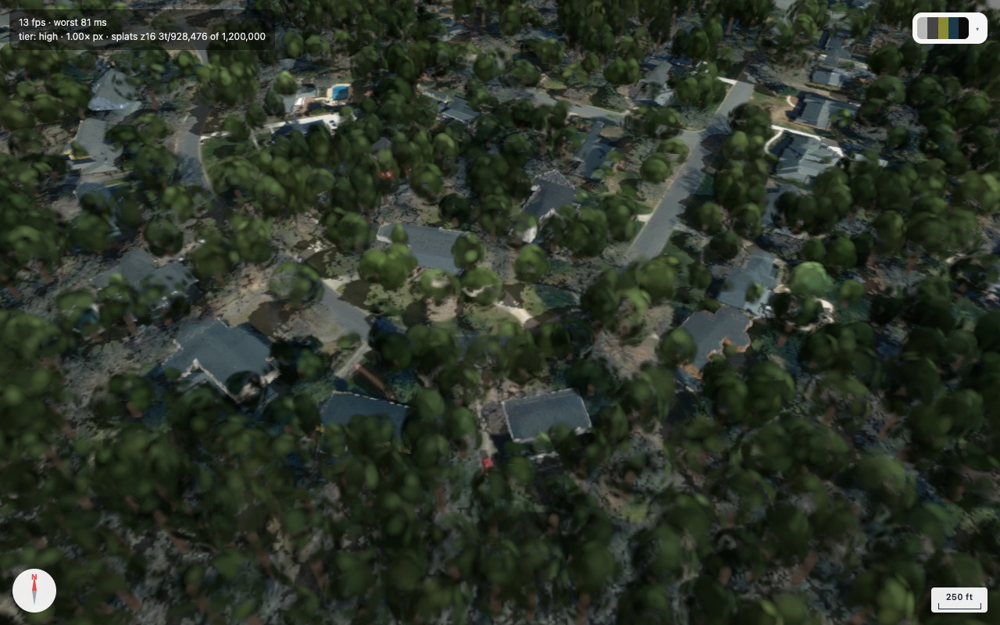

| camera 15.5 → z15 | camera 14.5 → z14 | mid-transition (z16 → z15) |
| --- | --- | --- |
| 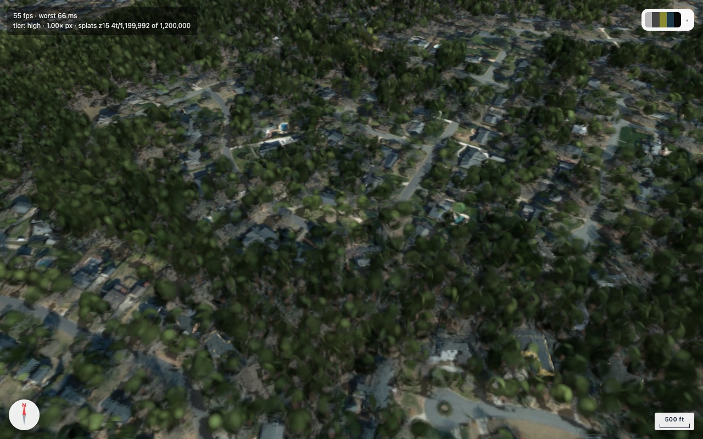 | 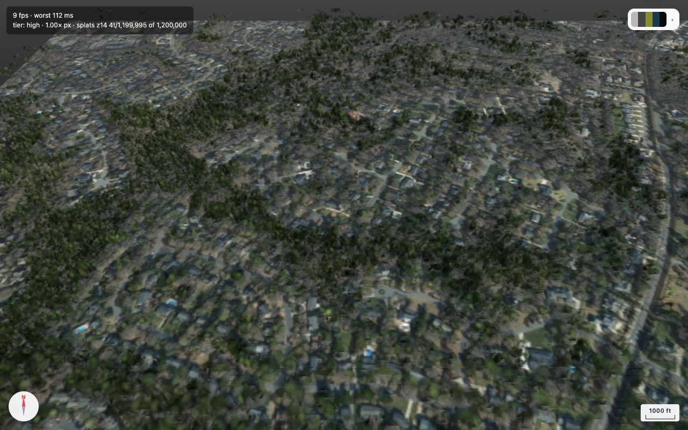 | 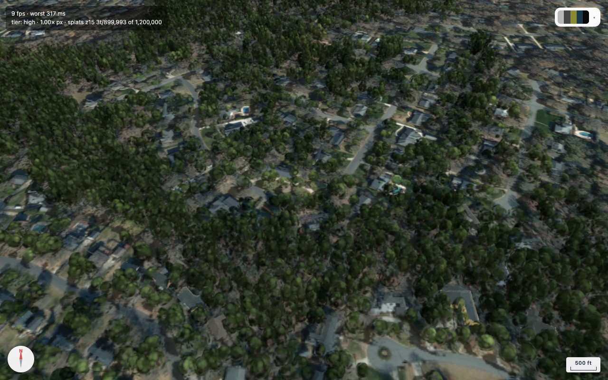 |

*Level transitions.* When the level changes the new level's window starts loading nearest-first and the old level's resident tiles **stay** — fetches and decoded-but-unseen tiles of the old level are abandoned, nothing on screen is. An old tile is released once the new level has taken over its ground: zooming **out**, when its ancestor tile has landed *and finished growing*; zooming **in**, when every descendant inside the new window is settled (grown, or known not to be coming), and the old window's periphery once the whole new window is. Release is the union's 300 ms shrink-out, so the two levels cross-fade through the union growth values and are never both at full density for longer than that; the imagery grounds of two levels are coplanar, so finer levels carry a larger polygon offset and win the depth test (no z-fighting: fine tiles grow *over* a coarse one, a coarse tile is *revealed* as fine ones shrink off it). The rounded union is computed **per level** — a tile only joins neighbours of its own level. `maxSplats` counts **both** levels during a transition and gives up old-level tiles first (those already shrinking out, then the farthest), when a new-level tile *lands* rather than when its fetch starts, so with the default budget a transition is a tile-for-tile swap that never exceeds the budget and never brings the basemap back. Zooming back before a transition finished regrows the old tiles instead of refetching them. If a level is **missing** under the camera (every tile of its window 404s — a tile set that ships only z16, or a pyramid still being built), the next finer level is used instead, then the coarser ones; 404s are remembered, so the probe costs one window of requests per level per place. A tile whose ancestor is missing stays as the fallback.

*Authoring.* Every level should carry a **similar per-tile splat budget** (SplatMap's pyramid builder merges four children and thins them back to the z16 budget, ≈ 300k) — that is what makes `maxSplats`, the tile count and the frame time level-independent. Each tile is authored in the frame of its own zoom (a z15 tile is 2× the edge of a z16 tile, origin at *its* SW corner), with its imagery at `{z}/{x}/{y}.png` of the same level. Levels may be sparse.

**Satellite ground.** Every loaded splat tile also gets a textured ground plane from `{z}/{x}/{y}.png` (the tiler's imagery, shadows baked in; same URL template with the extension swapped, or `imageryTemplate`), sRGB with mipmaps + max anisotropy, sitting 5 cm above the vector ground so the splats' ragged underside is hidden.

**Hybrid map (`hideBasemap: 'covered'`, the default).** The vector basemap is removed **only where the satellite has landed** — everywhere else it stays, so a small sharp satellite patch sits inside a complete map instead of on a bare ground plane. The overlay reports its rounded union — every resident tile of **every resident level** (both levels cut during a level transition), with the very growth / neighbour values its own GPU mask is using, plus the ripple front — to the tile-reveal `CoverageField`, which bakes it into the **second channel (G)** of the coverage texture (same signed-distance encoding as the reveal in R, stored as the unit-free ramp coordinate `s / 2·feather`; the texture doubles to 512² while a cut-out is reserved so a z16 splat tile gets ~8 texels). Every basemap shader already samples that texture by world XZ, so the one fetch now returns both channels and `hbdCoverage()` is `reveal · (1 − cut)`: houses, trees, grass, signs, cars, bridges, roads, water and foam **dither out exactly where — and as — the satellite grows in**. The cut is the exact complement of the imagery's alpha (`smoothstep(0, 2·feather, s) · rippleFront`), so the satellite's feathered rim and the vector map's cut dissolve into each other with no gap and no doubly-covered band. It works with `tileReveal: false` too (the shader chunk then only cuts). Labels go through `hbdCoverageLabel()` and **stay on top** of the satellite unless `keepLabels: false`. Buildings under the satellite cannot be hovered or clicked (`coverageAt` includes the cut). The 50 km ground plane and the z12 underlay are unmasked twins, as for the tile reveal. Nothing is hidden or suspended globally — your own `setLayerEnabled()` choices are untouched.

| growing in | settled | the seam, top-down |
| --- | --- | --- |
| 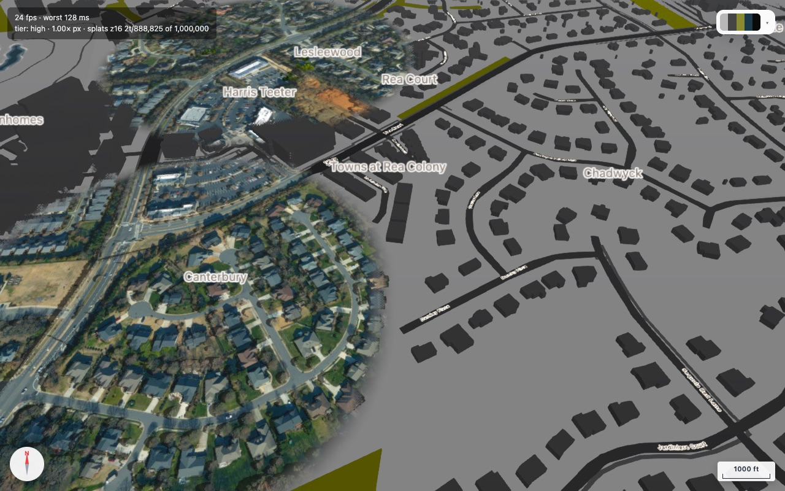 | 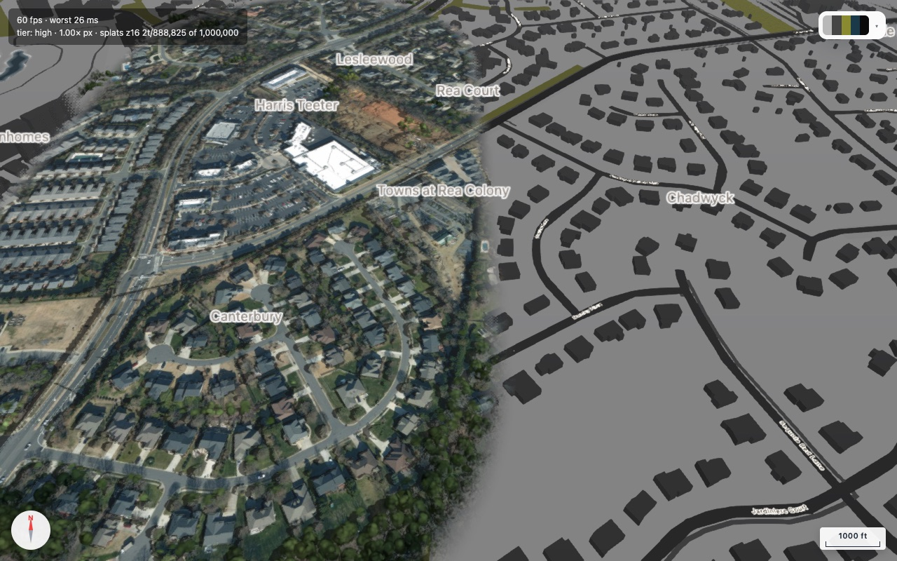 | 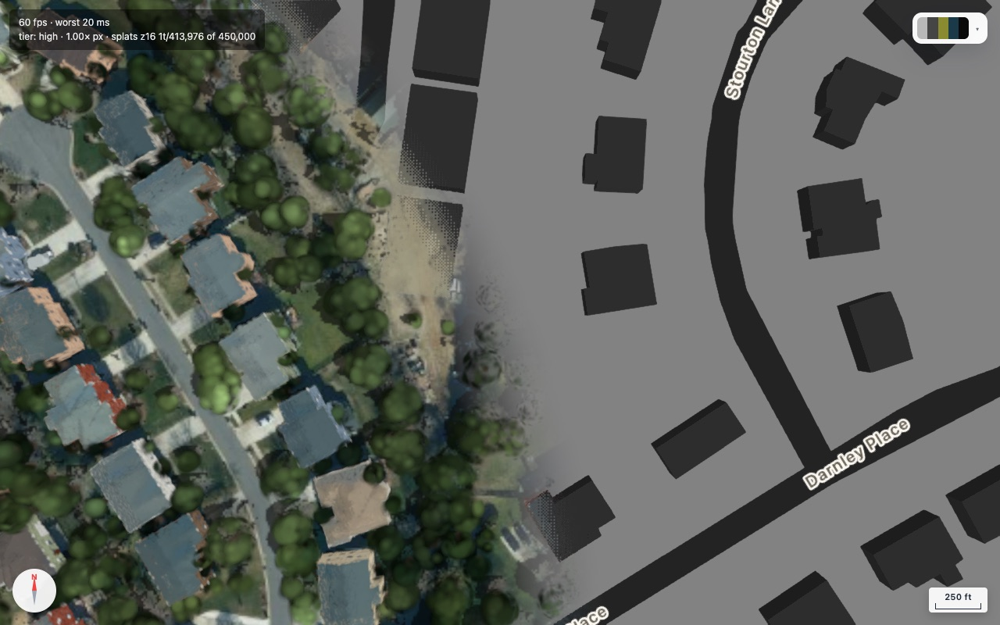 |

With `hideBasemap: true` (the old behaviour) the vector `buildings`, `roads`, `landuse`, `water`, `waves`, `trees`, `grass` and `labels` layers are instead masked out of the drawn scene **globally** while at least one splat tile is showing — a per-layer visibility mask in the tile manager, so nothing is rebuilt, decoding carries on, and your own `setLayerEnabled()` choices are untouched underneath; masked layers also stop ticking. Everything comes back the moment the last splat tile leaves or the overlay is disabled. `SPLATS_HIDDEN_BASEMAP_LAYERS` exports the list.

**Performance governor.** Splat cost is, to a very good approximation, **linear in the resident splats** — each one is an instanced quad transformed and rasterised every frame, and on an integrated GPU that vertex work *is* the frame (measured on an Intel Iris MacBook Pro at 1280×800: ≈ 80 ms per million splats; halving `maxStdDev`, quartering the viewport or spacing the sorts 10× apart moved nothing). So the lever that buys frame time is the budget, and the governor pulls it for you: while the picture is **moving** (camera motion, tiles or a ripple animating — idle frames and the frames around a tile upload are ignored) it tracks a smoothed frame time; over `targetFrameMs` (33) for four frames running it first thins the splats drawn **while moving** (`motionThin`: keep 70 %, then 50 %, then 35 %, survivors grown to keep the surface covered — nothing changes at rest), then cuts distant relief (`splatMaxDistance` 2000 → 1200 → 800 m), and only then scales the budget in effect down by `target / measured` (0.6–0.9 per step, at most every 500 ms, floor ×0.25 — the least relevant tiles **shrink out of the union** rather than vanish, and nothing more is admitted), and if frames are still over target on that floor for 1.5 s the `lodBias` in effect steps down by 0.5 (at most 1 below the configured value: coarser tiles, same count). It recovers slowly and one-sidedly — a knob is raised only after **4 s of moving frames under 0.7 × target**, bias first, then the scale ×1.25, then the distance, the thinning last; between "over" and "under 0.7×" nothing moves, and a raise that has to be taken back within 10 s doubles the wait for the next one (up to 60 s), so it never oscillates around a budget that straddles the target. `getSplatsStats().governor` reports `{ frameMs, targetFrameMs, scale, maxScale, biasDrop, splatMaxDistance, thinKeep }` (`maxSplats` / `tileZoom` already include them); `governor: false` switches it off. On that MacBook (quality `'high'`, default 1.2 M budget) a continuous orbit went from a mean of 86 ms / p50 100 ms to 50 ms / p50 33 ms, a zoom sweep through the levels from 99 ms to 44 ms, and the map no longer trips the auto-downgrade to `'low'`.

**Letting it grow (`budgetGrowth`).** By default the governor only ever *cuts*, which makes `maxSplats` a number that has to be safe on the weakest device it will run on — so every device above that line leaves its headroom unused. On the reference machine the shipping default settles at 3 tiles / 0.93 M splats at p95 19–22 ms with the governor never once engaging, on hardware that renders 2.15 M splats at 23 ms. Set `budgetGrowth` above 1 and the budget becomes a *starting point*: the same evidence rule that drives every other raise (4 s of moving frames under 0.7 × target per ×1.25 step, with the same regret back-off) keeps going past ×1, up to the ceiling you give it. Growth is deliberately the **last** raise in the order — bias, then the scale back to 1, then the distance cutoff, and only once nothing is degraded does the budget go above 1 — so it never grows while the picture is still recovering, and lowering the ceiling takes the lent-out growth back at once. Measured live on the reference machine at `budgetGrowth: 2`, two passes: 3–5 tiles / 0.93–1.05 M splats → 10–11 tiles / 2.11–2.23 M, i.e. **≈ 2.5× the 3D ground coverage for +1 ms of p95** (20–21 → 21–22 ms) at 59 fps and 0 % janky frames; the cost shows in the tail, p99 22–25 → 26–31 ms. It is off by default because it buys coverage with memory and bandwidth, not because it is unsafe — the governor still holds `targetFrameMs` either way. Judge it on more than one camera: the +1 ms above is at tilt 45, and at tilt 58 the same growth costs p95 20 -> 26 ms with 1-3 % janky frames. Heap cost for 3 tiles -> 9-10 is roughly +25-35 MB, and the `.spz` fetch count goes 3 -> 10-11.

**Growth answers for its own tail.** Granted budget is given back when long frames appear, stepping toward x1 with the same regret back-off that governs every other reduction. This needs a signal the rest of the governor deliberately ignores: `reportFrame` drops tile-upload and level-dissolve frames as "not draw cost" — correct for the average, since reading them would ratchet the budget down at every load, but wrong for growth, because a bigger budget means more resident tiles and so more uploads. They go to `noteHitch()`, which can only surrender budget above the configured one. The effect is that the same build adapts in opposite directions: on the reference desktop `budgetGrowth: 2` settles at 9 tiles / 2.29M splats, while an emulated phone tries it, sees a worst frame of ~185 ms, and settles back at 2 tiles / 300k with 0 % janky frames — without a tier rule saying so.

*Where the budget goes.* The window is ranked by **screen-space relevance**, not by grid distance from the centre tile: a tile's score is the squared distance of its centre's projection from the screen centre (`tileScreenRelevance`). Looking straight down that is ground distance from the *view centre* — so a four-tile budget is the 2×2 block around where the camera looks rather than an arbitrary plus — and tilted, perspective does the weighting: ground ahead of the target is preferred to ground beside it, tiles under or behind the camera come last (or never, on a tight budget), and the window itself is centred half the camera's ground offset ahead of the target (`viewFocus`). A resident tile only gives way to a candidate that scores 1.5× better, so an orbiting camera doesn't swap tiles back and forth.

*Idle cost.* Nothing renders while nothing changes. Trees, grass and shoreline foam animate continuously, though, and with the basemap no longer hidden they would force a render — and with it a full re-rasterisation of every resident splat — every frame (measured: 46 ms frames back to back on an idle map with `trees` + `grass` on). So while splat tiles are resident those ambient layers tick at 15 fps at most, never claim more than a quarter of the GPU (interval ≥ 4 × the measured frame cost), and freeze outright once that interval would pass 150 ms — a still tree beats a stuttering one (`LayerRegistry.setThrottle`). Camera moves and tile landings render at full rate as always; the limit lifts when the last splat tile leaves.

**Ripple reveal.** `setSplatsEnabled(on, { reveal: 'ripple', origin?, durationMs?, speedMps? })` animates the transition as an expanding circular front: from `origin` (`{ lat, lon }`, default the current view centre) the front radius grows at `speedMps` (default 250 m/s) for `durationMs` (default 1800 ms — so ≈450 m before everything is simply on). Splats inside the front pop up (scale 0 → 1 with a ~35 % overshoot just behind the front) and a ±10 % sine ring rides the front; splats beyond it stay collapsed (scale 0, opacity 0). The imagery ground fades in under the same front with a bright wave. It is a per-splat GPU modifier — a Spark `worldModifier` built with the `dyno` shader graph, so a million splats cost one uniform update per frame — plus a small ShaderMaterial on the ground. Tiles that stream in mid-ripple join the current front; disabling with `reveal: 'ripple'` plays it backwards and unloads the tiles once the front has collapsed. Calling `setSplatsEnabled(true, { reveal: 'ripple' })` while already on replays the reveal over the resident tiles. `reveal: 'none'` (the default) is instant. The pure maths (`rippleFrontRadius`, `rippleScale`, `rippleOpacity`, …) is exported from `splats/ripple.ts`.

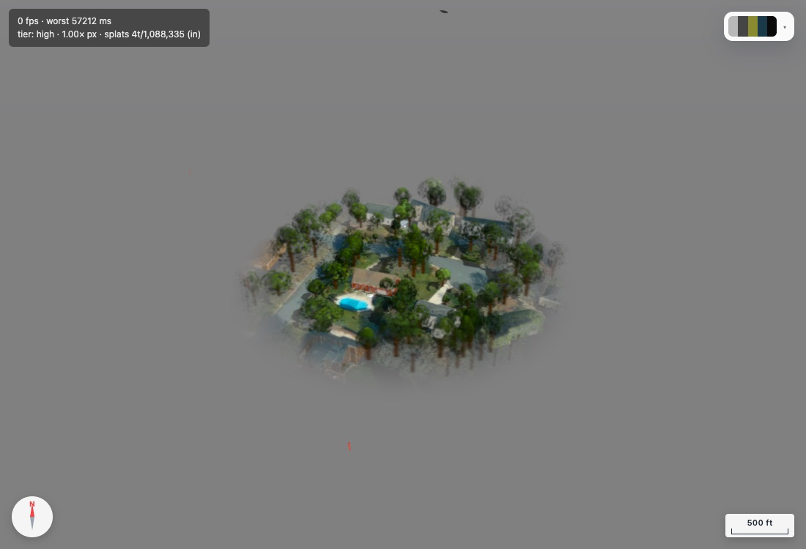

**Rounded union.** Loaded tiles never show as hard squares: the visible region is the *rounded union* of the resident tiles, "like a Bootstrap button group" — one tile is a circle one tile across (≈ 610 m at z16; that is also what a one-tile low-tier budget looks like), two edge-adjacent tiles a pill with the shared side fully joined, a complete 2×2 block a rounded square; outer corners are always round, interior joins seamless. Formally it is the morphological opening of the union of tile squares by a disc of radius half a tile: every point within half a tile of the *eroded set* — each tile's centre, the segment between the centres of two edge-adjacent tiles, the filled square between the four centres of a 2×2 block — so a tile needs only its 8 neighbour weights, and a point on a shared side gets the same value from both tiles (no gap, no double-dark band). It is one GLSL function (`ROUNDED_UNION_GLSL` in `core/roundedUnion.ts`) compiled into **both** consumers: a per-tile Spark `objectModifier` (tile-local frame, `(u, v) = center.xy / tileSize`, v north) that multiplies each splat's scale and opacity, and the imagery ground's fragment shader (plane UVs, v north) multiplying its alpha — sharing the same per-tile uniform vectors, so splats and ground cannot disagree. The soft edge is `2 × feather` wide (default `feather: 0.03` tile ≈ 18 m) and lies wholly inside the outline. It **animates**: a tile that lands grows from its centre over `growMs` (default 700 ms, ease-out); once it is ~60 % grown the joins toward it grow out from *both* sides (each bridge as thick as the thinner of its two tiles, so the seam matches at every instant), and a 2×2 block fills from its centre outward. A tile that drifts out of range shrinks away over 300 ms before it is unloaded; evictions that free budget are never delayed — the tile goes at once and only its neighbours' joins retract. The mask multiplies with the ripple reveal (ripple front × union) and is free at rest: Spark re-runs a tile's modifier only on the frames its weights actually change, and frames are requested only while something animates. `roundedUnion: false` restores square tiles; `{ growMs: 0 }` keeps the shape without the animation. The pure maths (`roundedUnionSigned`, `roundedUnionMask`, `unionGrowth`, `unionBridgeWeight`, …) is exported and unit-tested against a brute-force opening.

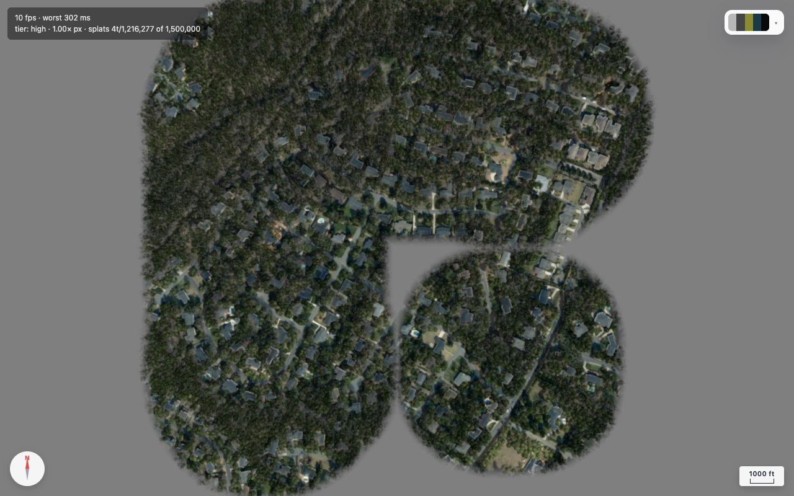

| one tile | two tiles | 2×2 |
| --- | --- | --- |
| 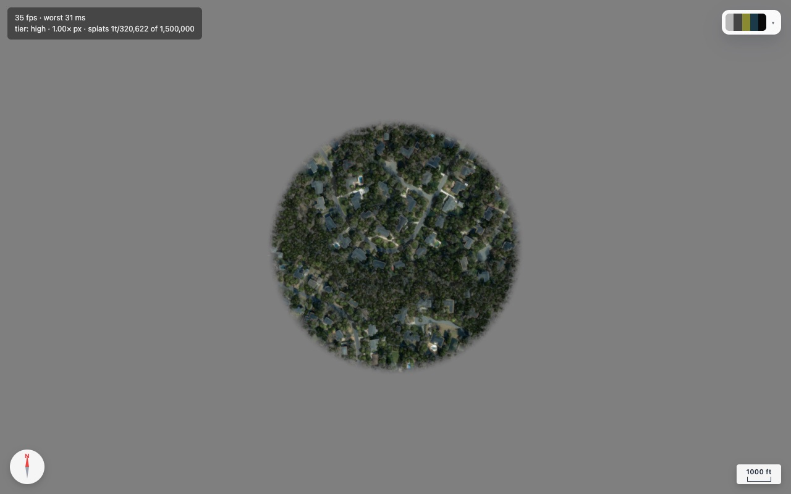 | 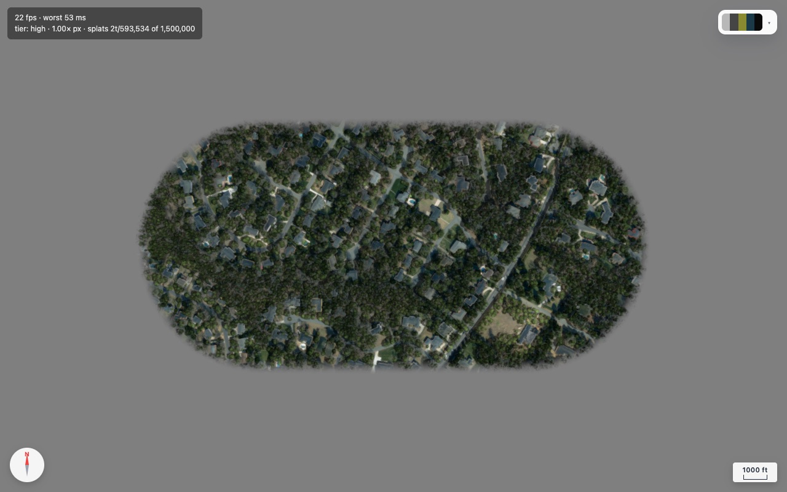 | 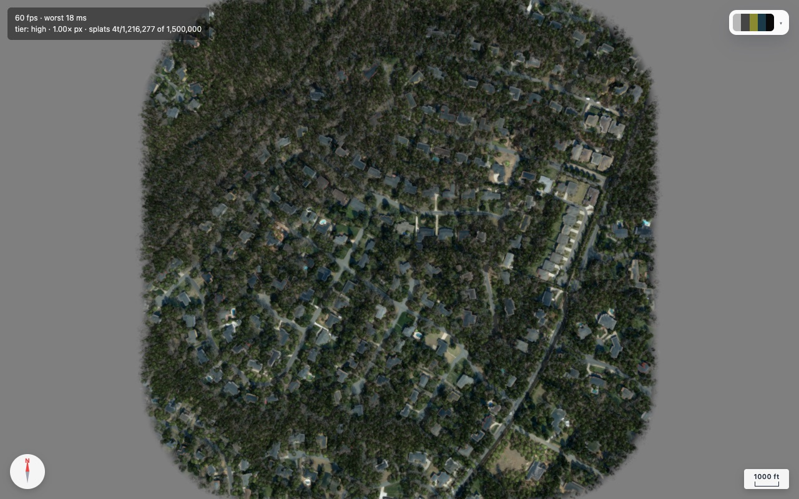 |

**Weight guidance.** Cost scales with *resident splats*, not tiles: every camera move makes Spark re-transform all of them on the GPU, read their depths back to the CPU (a main-thread stall until the GPU drains), sort them in a worker, upload a 4-byte-per-splat ordering texture, and rasterise them — and any frame the map redraws rasterises them again. So the overlay is governed by a **budget**, not by the window: tiles load from the view centre outward (the tile under the focus first, `maxInFlight` at a time), loading stops once the next tile would push residency past `maxSplats` (default **1.2M** on `'high'`), and when the view moves the farthest tiles are evicted to make room for nearer ones. The tile under the camera always loads, even if it alone exceeds the budget. At rest, decoded tiles and imagery textures land **in one frame** — every landing re-sorts the whole set, so a batch costs one sort stall instead of one per tile; while the camera moves they land one per frame, and with motion LoD splat tiles wait for the settle. On the `'low'` / `'mobile'` tiers (integrated / phone GPUs) the overlay stays available under `lowTierMaxSplats` (default **400k**, window radius ≤ 1, sorts ≥ 250 ms apart); set it to `0` to switch splats off there. Author tiles at **≤ ~300k splats** (SplatMap's `--max-splats`) — a 470k-splat tile alone overshoots the low-tier budget. Measured on an Intel Iris Plus 645 at 1280×800: ~6M resident splats (the old 5×5 default on heavy tiles) ran at ~450–550 ms per frame *at rest* with 1–2 s main-thread stalls on every sort; one 290k tile under the low-tier budget runs 17 ms at rest and ~33 ms while orbiting, with no frame over 100 ms. `getSplatsStats().maxSplats` reports the budget in effect. Splats and their ground planes are excluded from the sketch-outline normal pass. Around the detail, the next coarser level stays resident as a **cover** (`cover`, outside the budget), so the whole view is imagery while the budget buys detail from the centre out.

### Tile reveal

The vector basemap is only drawn inside the **rounded union** of the loaded tiles — the same shape (and the same maths, `core/roundedUnion.ts`) as the splats overlay: the morphological opening, by a disc of radius half a tile, of the union of the loaded tile squares. One tile shows as a circle, two adjacent tiles as a pill with the shared side fully joined, a 2×2 block as a rounded square, and the shape **grows** as tiles land: a new tile grows from its centre over `growMs` (700 ms, ease-out), and once it is ~60 % grown the joins toward its neighbours close from both sides. Outside the union you see what you saw before a tile loaded — the ground plane and, on the `'high'` tier, the low-res underlay; those two (and every overlay: parcels, polygons, tags, splats) are never masked.

| first tile | second tile | tiles landing | settled |
| --- | --- | --- | --- |
| 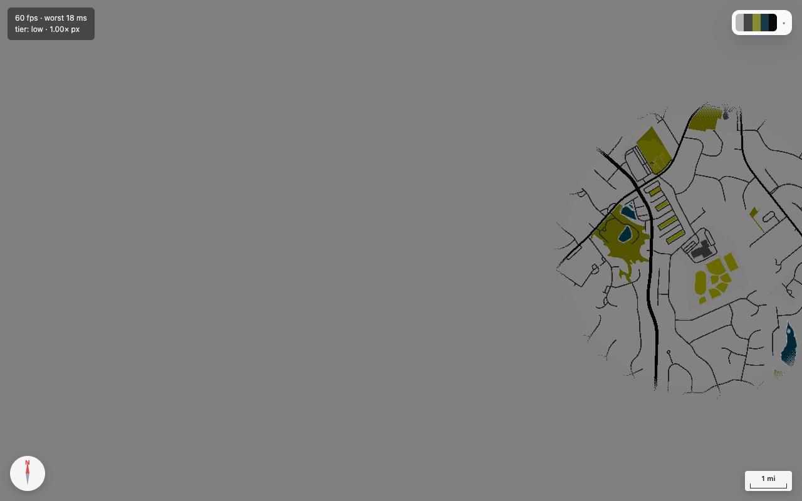 | 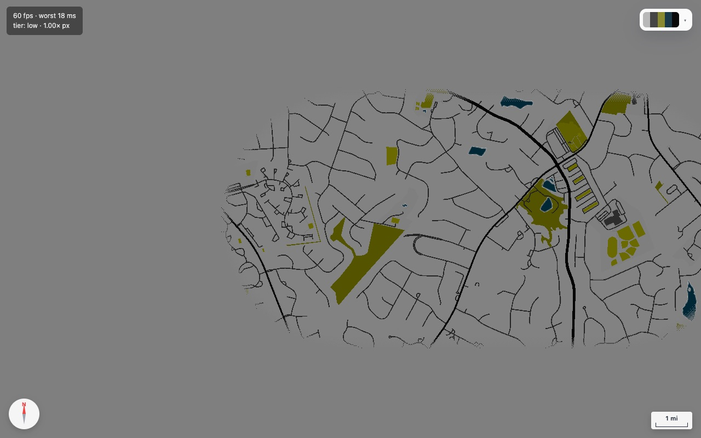 | 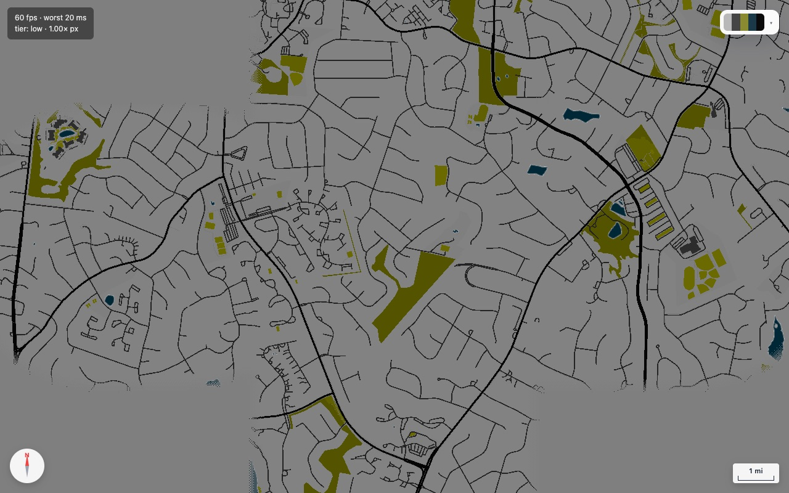 | 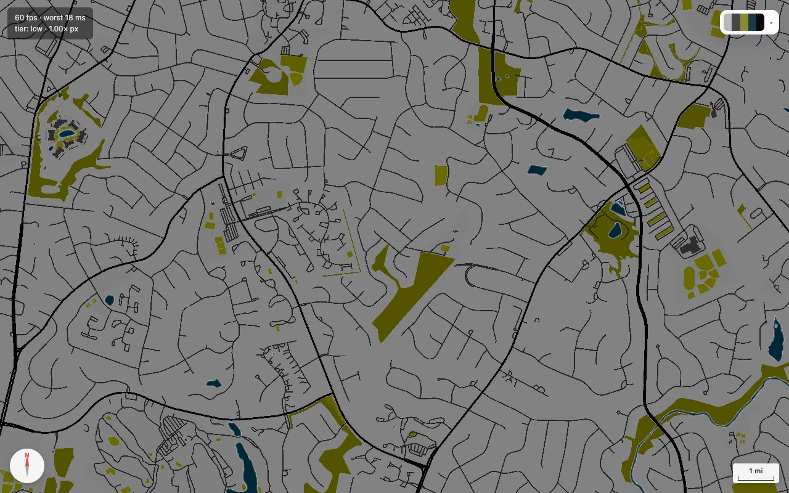 |

```ts
createHereBeDragons(el, { /* … */ tileReveal: { growMs: 700, feather: 0.03 } }); // the defaults
createHereBeDragons(el, { /* … */ tileReveal: false });                           // square tiles, slab rise
map.setTileReveal(false); // runtime toggle; getTileReveal()
map.setTileReveal({ growMs: 1200, feather: 0.06 }); // retune live (object form also switches it on)
map.getTileRevealOptions(); // { enabled, growMs, feather, rise }
```

How it works: basemap materials are shared across tiles, so there are no per-tile uniforms to animate. Instead a `CoverageField` bakes the shape on the CPU into **one small world-space texture** (256², RG8 — R is this reveal; G is the splat overlay's satellite cut-out, see *Hybrid map* above, and the texture is 512² while one is reserved) covering the tile manager's keep zone, snapped to tile boundaries so it only re-anchors (by shifting its contents) when the camera crosses into another tile — and every basemap shader samples it by world XZ. Because the lookup is by world position, things that span tiles (bridges, cars, street labels) follow the same outline for free. The texture stores the **signed edge distance**, not the mask: a distance field survives bilinear filtering, so ~17 texels per tile reconstruct a crisp round edge at any zoom, and the shader applies the feather at screen resolution. Opaque materials cut the soft edge with a 4×4 ordered dither (there is no MSAA, and the `'low'` tier renders at pixel ratio 1); transparent ones (waves, tunnels, labels) multiply their alpha; trees, grass and signs scale with the mask at their base, so they grow in rather than get sliced. It is free at rest: settled interior texels are exactly 1.0 (no dither crawl, and the settled map is pixel-identical to `tileReveal: false` except along the outer rim of the loaded area), and the field re-bakes only the tiles whose values changed, at most once per frame, only while something animates. Building hover / click / `getElevationAt` ignore geometry the mask has hidden.

With the reveal on, the old 30 m rise-from-below slab animation is off — a growing disc and a rising slab fight each other (and top-down the slab spends its first ~1.6 s hidden under the ground plane). Tiles land at ground level; buildings that arrive in the later decode phase grow up out of the ground over `tileSpawnDurationMs`. `tileReveal: { rise: true }` keeps both. Evictions are never delayed: the tile goes at once and only its neighbours' joins retract over 300 ms. A change of tile zoom (quality-tier flip) resets the field — another grid, another radius. While the splats overlay hides the basemap the field keeps tracking tiles, so the basemap comes back in the right state.

### Scale bar

A small `100 ft / 50 m` bar pinned bottom-right of the map. On by default, click to toggle units, defaults to imperial. Snaps to round-number steps so the label always reads like a number on a printed plan.

```ts
const map = await createHereBeDragons({
  container: '#app',
  source: { ... },
  scaleBar: { units: 'metric', targetWidthPx: 100 },  // or false to suppress
});
map.setScaleBarUnits('imperial');                     // runtime swap
const mpp = map.getMetersPerPixel();                  // build your own overlays
```

### Snapshot / screenshot export

Synchronous capture of the current view as a data URL. The render and canvas read happen in the same JS tick (no extra render-target plumbing), so it works with the default `preserveDrawingBuffer: false` (which is much faster for the normal render loop). DOM overlays (compass, scale-bar, tag popups) are not in the canvas and so not in the snapshot.

```ts
// Quick PNG at the current resolution
const dataUrl = map.snapshot();

// HiDPI for print / property reports
const hiRes = map.snapshot({ pixelRatio: 2 });

// JPEG with smaller file size
const jpeg = map.snapshot({ mimeType: 'image/jpeg', quality: 0.85 });

// Trigger a download
const link = document.createElement('a');
link.href = map.snapshot({ pixelRatio: 2 });
link.download = 'property.png';
link.click();
```

### Events

```ts
const off = map.on('ready', () => console.log('first tile request queued'));
map.on('tileload', (e) => console.log('tile', e.z, e.x, e.y));
map.on('tileerror', (e) => console.warn(e.error));
map.on('viewchange', (v) => console.log(v.lat, v.lon, v.zoom));
off();          // unsubscribe
```

`ready` fires once, while `createHereBeDragons()` is still pending, and it is *latched*: a
listener added after it fired (any listener added after `await createHereBeDragons(...)`) is
called once, on the next microtask. Every other event is delivered only to the listeners present
when it fires.

### Lifecycle

```ts
map.resize();          // call from your window.resize handler
map.destroy();         // releases GPU resources + DOM

// Perf introspection: wire these into your own HUD / telemetry without
// touching internals. Sampled on render frames only (hidden-tab frames don't
// pollute the EMA); reset on every visibility-resume.
map.getFrameMs();      // smoothed RAF-to-RAF, e.g. 16.7
map.getFps();          // derived from getFrameMs(), e.g. 60
map.getQualityTier();  // 'low' | 'mobile' | 'high'
map.getPixelRatio();   // currently-applied DPR (drops during dynamic-res motion)
```

The renderer survives WebGL context loss out of the box: the canvas opts into restoration (`preventDefault` on `webglcontextlost`) and `three`'s `WebGLRenderer` re-uploads its textures, programs, and buffers on the matching `webglcontextrestored` event. The map automatically forces a redraw once the context is back, so a long tab-background or a GPU driver reset doesn't kill the map.

The render loop also **pauses entirely when the tab is hidden** (`document.visibilitychange`), so a map embedded in a backgrounded tab costs zero CPU + GPU until the user returns to it. The first resumed frame uses a fresh delta so damping/clouds don't snap.

---

## The Studio (`createMapStudio`)

The Studio is an in-browser control panel for designing a map without writing code. It edits a live `HereBeDragons` and exports its state as a JSON config.

```js
import { createHereBeDragons, createMapStudio } from '@cottagehop/here-be-dragons';

const initialConfig = {
  center: { lat: 40.7065, lon: -74.009 },
  zoom: 15,
  pmtiles_url: '/tiles.pmtiles'
};

const map = await createHereBeDragons(document.getElementById('app'), initialConfig);

createMapStudio(map, {
  initialConfig,                  // round-trips pmtiles_url / pixelRatio / etc.
  onExport: (cfg) => {
    // Optional: intercept the export. Return `false` to suppress the default
    // file download (e.g. POST the config to your backend instead).
    console.log('exported', cfg);
  }
});
```

### What the Studio panel exposes

- **Theme picker** visual grid of every registered theme (filterable via the `themes: [...]` option)
- **Custom colors** `land`, `building`, `park`, `water`, `road`, `beach`, `sky` color pickers (applied on top of the active theme)
- **Selection highlight** popup toggle + building/floor color pickers
- **Camera** tilt, bearing, zoom sliders, kept in sync as the user drags on the canvas. Each slider has a `↔` toggle that opens a **Min / Max** sub-editor: turn it on to limit how far the camera can move on that axis. The exported JSON includes `tiltRange` / `bearingRange` / `zoomRange` only for axes whose toggle is active.
- **3D Satellite (splats)** a foldable section for the Gaussian-splat overlay. A **Tile URL** field (plus an optional imagery template / "Satellite ground" switch): with no `splats` option on the map the field starts empty and everything below it is disabled — paste a `{z}/{x}/{y}.spz` template and the overlay is **created at runtime**. Then: an **Enabled** toggle (plays the configured reveal from the current view centre — overlays the Studio creates default to the ripple), a live stats line showing the active pyramid level (`on · z16 · 1 tile · 474,849 / 640,687 splats · reveal none · basemap cut out · governor 31 / 33 ms → budget ×0.53`, polled at 2 Hz only while the section is open), sliders for min zoom, the tile pyramid (coarsest / finest tiles, detail bias, low-tier bias, max camera zoom), window radius, the `maxSplats` budget and the low-tier budget, a **Frame governor** switch + target frame time, a **Basemap** mode (Cut out / Hide / Keep = `hideBasemap: 'covered' | true | false`) with a **Labels on top** switch, a `Neutral grade` switch, rounded union on/off + feather + grow, reveal style (None / Ripple) + duration + speed, and an **Advanced** fold with `maxStdDev`, sort interval and max in flight. Everything goes through `map.setSplatsOptions()`, so sliders apply live and only the URL fields / the union switch rebuild the layer. Round-trips through the exported JSON `splats` block (defaults elided, never an empty block).

  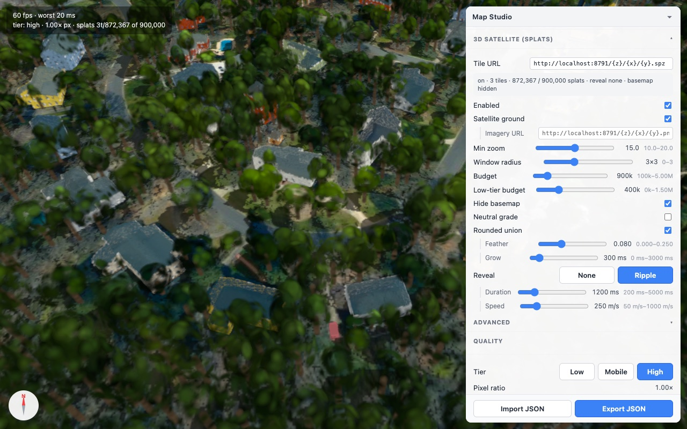
- **Layers** per-layer checkboxes (`water`, `landuse`, `roads`, `buildings`, `trees`, `grass`, `waves`, `labels`, `cars`) plus a "flatten buildings" toggle. `grass` (wind-blown meadow tufts) and `waves` (animated shoreline foam) are off by default; toggling them on re-decodes the visible tiles to build their geometry. Each checkbox round-trips through the exported JSON `layers` map.
- **Quality** live `Low` / `Mobile` / `High` tier switch with a read-only pixel-ratio readout. Flipping to `Mobile` forces the ambient FX off and caps the pixel ratio; `Low` drops to a top-down flat view. The chosen tier round-trips through the exported JSON `quality` field (an untouched `'auto'` map stays `'auto'`).
- **Clouds** enable/disable + opacity slider
- **Cloud Look** coverage, density, altitude band, noise scale, wind speed sliders + cloud/shadow color pickers
- **Lighting** sun color + intensity, fill, ambient, hemisphere sky/ground colors + intensity
- **Painterly FX** surface wash, paper grain, road texture sliders, spores toggle, and a global wind slider
- **Buildings (painterly)** strength + floor-height sliders, roof + window color pickers, and a pitched-roofs toggle
- **Signs** banner density + min-zoom sliders
- **Outline / Ink** edge strength + darkness, halftone, hatching, and saturation sliders
- **Performance** the smoothness-vs-detail tradeoff: `Load tiles while moving` (inverse of `interactionTilePriority`) and `Motion blur (faster)` (`dynamicResolution`). Both round-trip through the exported JSON.
- **Animation** tile pop-up time, plus the basemap **Tile reveal** control: on/off, grow ms, feather and the legacy slab rise (`map.setTileReveal()`); exported as `tileReveal` only when it differs from the default.
- **Compass** show/hide overlay toggle
- **Import JSON** button loads a config file (e.g. a previously exported one) and applies every editable setting to the live map, syncing all panel controls to match
- **Export JSON** button downloads `here-be-dragons.config.json`

### `StudioOptions`

| Field | Type | Default | Description |
|---|---|---|---|
| `container` | `HTMLElement` | `document.body` | Mount point. |
| `open` | `boolean` | `true` | Initial expanded state. |
| `injectDefaultStyles` | `boolean` | `true` | Inject the panel's CSS into `<head>`. |
| `themes` | `string[]` | all registered | Subset of theme names to show. `[]` hides the section. |
| `compass` | `boolean` | inherit | Force the compass overlay on / off at construction. |
| `initialConfig` | `Partial<HereBeDragonsOptions>` | `{}` | Source of non-queryable fields (`pmtiles_url`, `pixelRatio`, `background`). |
| `onExport` | `(cfg) => boolean \| void` | `undefined` | Intercept the export. Return `false` to suppress the default download. |
| `onImport` | `(cfg) => boolean \| void` | `undefined` | Intercept the parsed config before it's applied. Return `false` to apply it yourself via `setConfig`. |

### Studio handle

```ts
const studio = createMapStudio(map, { initialConfig });

studio.getConfig();    // read current config without exporting
studio.export();       // trigger the export flow programmatically
studio.setConfig(cfg); // apply a config to the live map + sync the panel controls
studio.setOpen(false); // collapse the panel
studio.destroy();      // remove DOM + listeners
```

### Adding a control that isn't there

The Studio's section list is currently hard-coded. To add a control not in the panel today, mount your own DOM next to the studio panel and call the map's API directly:

```js
const studio = createMapStudio(map, { initialConfig });

// Mount custom controls in your own panel.
const myPanel = document.createElement('div');
myPanel.innerHTML = `
  <label>Time of day
    <input id="tod" type="range" min="0" max="24" step="0.1" value="12" />
  </label>
`;
document.body.appendChild(myPanel);

document.getElementById('tod').addEventListener('input', (e) => {
  const hour = Number(e.target.value);
  // example: rotate the sun by tying it to bearing for a quick visual sweep
  map.setBearing((hour / 24) * 360 - 180);
});
```

If you need a control to round-trip through the exported JSON, write it into the JSON yourself after `studio.export()` returned its config or open an issue describing the use case and we'll add a first-class API.

---

## Config round-trip (the recommended workflow)

```js
// 1. Design the map in Studio. Click "Export JSON". You get something like:
{
  "center": { "lat": 40.7065, "lon": -74.009 },
  "zoom": 15.4,
  "tilt": 55,
  "bearing": 0,
  "pmtiles_url": "/tiles.pmtiles",
  "theme": "concretejungle",
  "customColors": { "water": "#0a2030" },
  "clouds": { "enabled": true, "opacity": 0.7 },
  "compass": true,
  "fog": { "tiltStart": 30, "tiltEnd": 40, "strength": 1 },
  "labelHeight": 75,
  "tileSpawnDurationMs": 450,
  "layers": { "water": true, "buildings": true, "trees": true, "grass": false, "waves": false, "cars": false },
  // Only when a splat tile URL is set, and only the keys that differ from the defaults:
  "splats": {
    "urlTemplate": "https://tiles.example.com/splats/{z}/{x}/{y}.spz",
    "maxSplats": 900000,
    "roundedUnion": { "feather": 0.08, "growMs": 300 },
    "reveal": { "reveal": "ripple", "durationMs": 1200 }
  },
  "tileReveal": { "growMs": 1200 }          // omitted at the defaults; `false` when switched off
}

// 2. Save that file alongside your site assets (e.g. /public/map-config.json).

// 3. Load it in a single fetch + createHereBeDragons call:
const cfg = await fetch('/map-config.json').then((r) => r.json());
const map = await createHereBeDragons(document.getElementById('app'), cfg);
```

The map renders identically to what you designed in Studio. No imperative setup. No `applyTheme` / `setCloudsOpacity` / `setLayerEnabled` calls.

**Splats + tile reveal in the round-trip.** Unlike the other sections (which export every value), the `splats` and `tileReveal` blocks are written *sparsely*: keys equal to their default are left out, `splats.clock` is never written, and there is no `splats` block at all while no tile URL is set — so a map that never touched them exports exactly what it did before. Import is the inverse: a `splats` block **replaces** the live options (keys it leaves out go back to their defaults) and creates or rebuilds the layer as needed, so Export → reload → Import lands on the same overlay; a file without a `splats.urlTemplate` leaves the overlay alone (like `pmtiles_url`, the tile source is per-environment), and a file without `tileReveal` means the default reveal. `studio.setConfig(partial)` called from code stays partial: it only touches `tileReveal` / `splats` when the key is there.

---

## Performance tuning

### How tile decoding works

Every tile in the visible window goes through this pipeline:

1. **Fetch** PMTiles range-request returns the raw MVT bytes. Async, non-blocking.
2. **Worker decode** handed to one of the worker threads (round-robin). Inside the worker, decoding runs in **two phases**:
   - **Phase 1 (base)** water, waterways, landuse, roads, rails, labels. Cheap to extract (~5–15 ms). Posted back immediately.
   - **Phase 2 (buildings)** the heavy one. The union-find that groups multi-part buildings is O(n²) over features in the tile, so a dense Manhattan-scale tile spends 50–200 ms here. Posted back when it finishes.
3. **Scene update** the main thread builds three.js meshes from each phase's geometry and adds them to the tile's group as soon as they arrive. The base map appears within milliseconds; buildings fill in afterward.

The two-phase split means **users see streets, water, and labels almost instantly** even while building decoding is still grinding. Disabling the `buildings` layer entirely skips phase 2 in the worker.

### Default tile load (at z=15)

The dispatcher is **frustum-aware**: each frame, the camera's four screen corners are raycast onto the ground plane to compute a tile-coordinate bbox of what's actually visible. Only tiles inside that bbox (plus a 1-tile margin) get loaded. With a 55° camera tilt, the visible region is a trapezoid mostly in front of the camera target typically 20–40 tiles at z=15, not the symmetric square the older Chebyshev approach loaded.

| Knob | Default | Result |
|---|---|---|
| `visibleRadius` | `3` | tier-0 priority radius around camera target |
| `tileWindowRadius` / `tileWindowRadiusFar` | `6` / `6` | safety cap on tile count when the camera looks near horizon (radius from target) |
| `workerPoolSize` | `min(4, hardwareConcurrency − 1)` | 3–4 worker threads |
| `maxTileApplyMsPerFrame` | `3` | per-frame ms budget for applying decoded tiles to the scene |
| `dispatchInterval` | `4` | heavy visibility/dispatch pass runs every N-th RAF tick (≈ 15 Hz at 60 FPS) |

Two-tier within the bbox:

- **Tier 0** within `visibleRadius` of the camera target. These dispatch first.
- **Tier 1** the rest of the frustum bbox (with margin). Dispatched after tier 0.

The candidate set is the camera frustum's actual ground footprint a convex **trapezoid**, not its bounding box. Every candidate tile is point-in-quad tested against that trapezoid (inflated by a 1-tile margin for smooth panning), so the big off-screen triangles at the near-edge corners of the bounding rectangle never get loaded.

Within each tier the order is a **concentric ring expansion from the camera target** (the screen center) closest squared-Euclidean distance first. Same-ring tiles tiebreak right-before-left so the fan stays visually symmetric.

Tile builds are bounded by a per-frame ms budget (`maxTileApplyMsPerFrame`) so a burst of worker completions can't block pointer/wheel input. The drain loop applies tiles closest to the camera first and yields once the budget is spent (always applying at least one tile per frame so the queue can drain even when a single build exceeds the budget). The heavy "what's visible now?" recompute runs only every `dispatchInterval` frames (default 4 → ~15 Hz at 60 FPS), also borrowed from PolyMap tile fetches are network-bound and decodes take 50–200 ms in workers, so polling visibility at 60 Hz was wasted main-thread work that competed with input and rendering. **You can pan and zoom during the initial load.** As you pan, the frustum bbox shifts and new tiles are dispatched at the new viewport; tiles outside the new bbox stay in the LRU cache for a short grace period.

### Tuning options

Pass a `performance` object to `createHereBeDragons`:

```js
await createHereBeDragons(el, {
  center, zoom, pmtiles_url,
  performance: {
    visibleRadius: 3,             // smaller "in viewport" set (49 tiles)
    tileWindowRadius: 6,          // shrink the pre-loaded buffer (~169 tiles)
    tileWindowRadiusFar: 8,
    workerPoolSize: 2,
    maxTileApplyMsPerFrame: 3     // tighter budget = smoother input under load
  }
});
```

Concrete trade-offs (frustum-aware loading; "tiles loaded" is the typical count after the frustum-bbox intersection with the radius cap):

| Profile | `visible` / `window` / `far` | Typical tiles loaded | Behavior |
|---|---|---|---|
| Default | 3 / 6 / 6 | ~25–40 (frustum-clipped) | Tight viewport-only, snappy load, pop-in only on very fast pans |
| Buffered | 4 / 8 / 10 | ~60–120 | Wider buffer, smoother fast-pan, slower first paint |
| Mobile | 2 / 4 / 4 | ~12–25 | Strictest, fastest load, visible pop-in |
| Pre-cached | 5 / 12 / 14 | ~200–400 | Big buffer, almost no pop-in, slower initial load |

Other levers built into the library:

- **Disable layers you don't need** `layers: { rails: false, cars: false, labels: false }`. Disabled layers are now skipped at the worker level entirely (no decode cost), not just hidden post-render.
- **Disable buildings if you only need the base map** the heaviest single extractor. `layers: { buildings: false }`. Frees ~70% of worker CPU per tile.
- **Disable clouds** `clouds: false`. Saves a full-screen raymarch pass every frame.

### Quality tiers

On lower-end GPUs / integrated graphics / mobile, the per-frame rendering cost can dominate independent of tile loading. The map runs a multi-pass pipeline (color, normal-for-outlines, outline, clouds, FXAA) at the canvas's native pixel ratio, so a 2× Retina display means ~4× the pixel work of a 1× display.

The `quality` option handles this for you:

```js
await createHereBeDragons(el, {
  center, zoom, pmtiles_url,
  quality: 'auto'   // the default detects the GPU and downgrades if needed
});
```

- **`'auto'`** (default) first checks whether it's running on a phone/tablet (by platform, since iOS Safari redacts the GPU string so a probe can't help). If so it starts on **`'mobile'`**. Otherwise it probes the GPU via `WEBGL_debug_renderer_info`: Intel integrated graphics (e.g. the Iris Plus in a 2019 MacBook Pro 13"), software rasterizers, and "no WebGL" all resolve to `'low'`; discrete GPUs, Apple Silicon, and privacy-redacted renderers stay `'high'`. It only ever *downgrades* on a confident match, so a capable machine is never blurred by mistake.
- **`'mobile'`** the most capable map a phone-class GPU (e.g. an **iPhone 8**, 2 GB RAM) can sustain. Keeps the realty essentials (**3D buildings, labels, tags/markers, parcels, comp radius, tap-select + hover popups**) and drops only the cinematic dressing: clouds, sketch outlines, and the ambient layers (trees, grass, waves, signs, cars, spores, painterly wash) are forced off regardless of theme. Caps `pixelRatio` to 1.5, disables the low-res underlay to save GPU memory, tightens the tile window, and caps tilt at 60°. Detected automatically under `'auto'`; a phone too weak even for this auto-downgrades to `'low'`.
- **`'low'`** a top-down 2D fallback for the weakest devices: `pixelRatio` capped to 1 (no Retina super-sampling the single biggest fill-rate win, ~4× fewer pixels), MSAA off (FXAA alone handles AA), flat building footprints (no extrusion), labels off, and a tighter tile-load window.
- **`'high'`** full desktop quality: `pixelRatio` up to 2, clouds + outlines available per theme, default tile window.

An explicit `pixelRatio` or any `performance.*` field always overrides what the tier would have set so you can force `quality: 'mobile'` but keep `pixelRatio: 2`, or stay on `'high'` but tighten the tile window.

> **Building a real-estate app for phones?** You don't need to do anything: `quality: 'auto'` already serves the `'mobile'` tier to handset visitors. To preview it on desktop, pass `quality: 'mobile'` explicitly (pair it with the `professional` theme and the [real-estate listing presets](#real-estate-listing-presets) for the full client-facing listing map).

If you want to go further than `'low'`, the individual knobs are still there:

```js
await createHereBeDragons(el, {
  center, zoom, pmtiles_url,
  quality: 'low',
  clouds: false,                  // skip the cloud raymarch pass
  layers: {
    rails: false,                 // skip ribbon + crosstie geometry
    labels: false,                // skip the sprite-text overlay
  },
  performance: { maxTileApplyMsPerFrame: 3, workerPoolSize: 2 }
});
```

## Hosting your tiles

`pmtiles_url` accepts any URL the browser can fetch absolute, relative, or `https://`. The library uses range requests, so your server must support `Range:` headers (S3, CloudFront, GCS, plain Apache/nginx all do).

For local development, drop a `.pmtiles` archive into your `public/` directory and reference it as `'/tiles.pmtiles'`. Build it from OpenStreetMap with [Planetiler](https://github.com/onthegomap/planetiler) or grab one from [Protomaps](https://protomaps.com/).

---

## Bundling notes

**What you actually ship.** The published `dist/index.js` is ~963 kB / 253 kB gzipped, but that is
not what a consumer pays: it is shipped **unminified on purpose**, so your bundler minifies once and
can tree-shake. Measured by bundling this package with esbuild (minified, `three` and
`@sparkjsdev/spark` external, which is how it is meant to be consumed):

| what you import | raw | gzipped |
| --- | --- | --- |
| `createHereBeDragons` (the map) | 525 kB | **151 kB** |
| + `createMapStudio` | 589 kB | 167 kB |

So the Studio really does drop out when you do not import it. For scale, MapLibre GL JS is around
200 kB gzipped, and that is a 2D vector map without the 3D buildings, terrain and splat overlay.
`three` is a peer dependency and is never bundled here — you already ship it, or you do not use the
library. Spark is dynamic (see below) and is not in either figure.

The decode worker is bundled automatically when you use Vite, Rollup, esbuild, or Webpack 5 `import.meta.url` resolution handles the worker file location for you. If you're on an older bundler that doesn't, file an issue with the bundler name.

The Gaussian-splat overlay depends on `@sparkjsdev/spark`, declared as an **optional** peer dependency and reached through a bare dynamic `import('@sparkjsdev/spark')` that is left as-is in the published bundle. If you never pass a `splats` option the import never runs and your bundler's tree of the map is unchanged; if you do, `npm i @sparkjsdev/spark` and your bundler will code-split it into its own chunk (Spark ships a WASM sorter, so it's a few hundred KB). Without it installed the overlay logs one warning and stays inert.

The library injects its own CSS for tags, compass, building popup, and Studio. If you want to preload styles to avoid a flash, import them explicitly:

```js
import '@cottagehop/here-be-dragons/styles.css';   // (planned currently auto-injected)
```

---

## TypeScript

Everything is typed. The big ones to know:

```ts
import type {
  HereBeDragons,
  HereBeDragonsOptions,
  ThemeName,
  ThemeColors,
  LayerName,
  TagOptions,
  TagHandle,
  PolygonOptions,
  BuildingInfo,
  StudioConfig
} from '@cottagehop/here-be-dragons';
```

`ThemeName` autocompletes the built-in themes but accepts any string at runtime so you can register custom themes.

---

## Reference: full feature list

- **3D vector tile rendering** PMTiles + MVT, decoded in a Web Worker
- **Stylized shading** with multi-pass outline pass (depth + normals)
- **Volumetric raymarched clouds** that drift over the city
- **Animated traffic** along the road network (opt-in `layers: { cars: true }`)
- **Rail tracks** with crossties, drawn under the road layer (for "subway under street" effect)
- **Waterways** rivers/canals as continuous channels
- **Interactive building selection** click to highlight, optional floor band, blueprint mode
- **Tag overlay** with automatic clustering at distance
- **Custom polygons** with translucent fills + a geodesic comp-radius helper
- **Parcels overlay** clickable county parcel boundaries from a second PMTiles archive
- **Gaussian-splat overlay** streams pre-tiled `.spz` / `.ply` splats over the basemap via the optional Spark peer dependency
- **15 built-in themes** + custom theme support
- **Studio** for live editing + JSON export (full config round-trip)
- **Scale bar** + **compass overlay** + camera flyTo + bounded panning
- **Snapshot / screenshot export** (HiDPI PNG/JPEG)
- **Quality tiers** (`auto` / `mobile` / `low` / `high`) with phone auto-detection
- **Optional Geolocation** integration

---

## License

Source-available, no-resale. You may use, modify, and distribute HereBeDragons
for free, including inside a commercial product or service, but you may not sell
or resell the software itself (or a derivative of it) as the primary thing of
value. See [LICENSE](LICENSE) for the exact terms.
