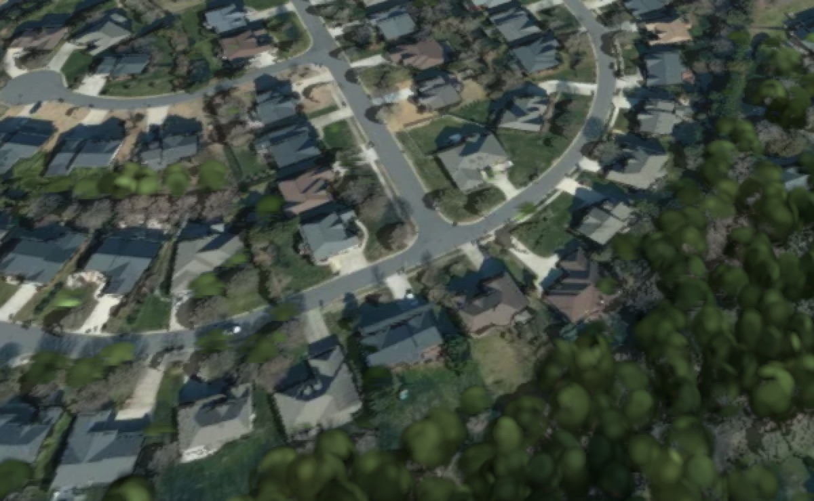
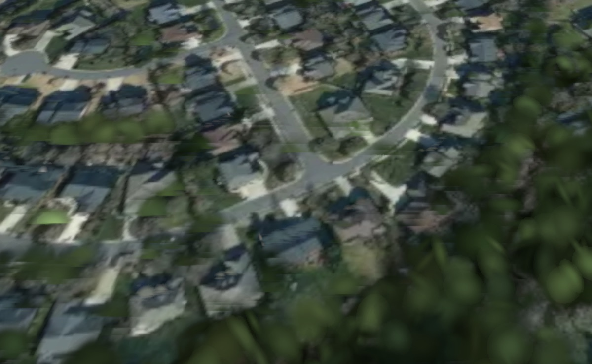

# Per-tile level selection (design note, not yet implemented)

## Why

One pyramid level currently serves the whole splat window (`SplatsLayer.activeZ`). A tilted
camera wants two different things at once, and one level cannot give both:

- the **near field** (bottom of frame) is metres from the camera and needs the finest level;
- the **far field** (toward the horizon) is kilometres away, where a splat is sub-pixel.

Measured at camera zoom 15.2 / tilt 58, 1280x800, with the two rules we have today:

| rule | level | tiles | splats | near field | coverage |
| --- | --- | --- | --- | --- | --- |
| `levelSelection: 'bias'` (default, `lodBias` 1.5) | z16 | 3 | 0.93M | sharp — roof ridges, kerbs, trees with 3D form | only ~40 % of frame; the rest is grey vector basemap |
| `levelSelection: 'resolution'`, `resolutionMargin` 0.5 | z15 | 8 | 1.20M | **visibly smeared** — horizontal streaking across roofs, trees flattened to green smears | full frame, satellite all the way to the horizon |
| `levelSelection: 'resolution'`, `resolutionMargin` 0.25 | z16 | 3 | 0.93M | same as bias | same as bias |

Near-field crops of the first two rows, same camera, same 600x370 region scaled 2x:

| z16 (`bias`) | z15 (`resolution`, margin 0.5) |
| --- | --- |
|  |  |

The z15 near-field damage is not a dissolve artifact — a cold load with a 30 s settle produces a
pixel-identical result. It is what z15 surfels look like when viewed from near-field distance under
tilt: each splat covers many pixels and the anisotropic stretch shows as streaks.

So neither rule is right: the two images above are each better than the other in exactly the half of
the frame the other is worse in.

### But first — most of that coverage gap was a BUDGET problem, not a level problem

`bias` covered only ~40 % of the frame because it was capped at 3 tiles, not because z16 is too fine
to reach the horizon. With `budgetGrowth: 3` (see CHANGELOG) the same camera settles at **z16, 9
tiles, 2.15M splats** — satellite across nearly the whole frame, with a near-field crop
indistinguishable from the z16 one above, at 60 fps and a worst frame of 20 ms. That is more tiles
than `resolution` mode's 8, at the *sharp* level.

**So the coverage-vs-sharpness trade is mostly a false one, and the answer is a bigger budget rather
than a coarser level.** This lowers the urgency of everything below. What per-tile selection is still
worth building for is the residual: the thin grey strip along the top of the frame, i.e. ground
beyond the window's reach, where even a grown budget cannot help because those tiles would be z16
tiles spent on ground that is kilometres away and sub-pixel. That is a real win, but it is the far
field only — the near field is already solved.

`resolutionTiltAware` (the softened near-edge factor) is a one-level-wide sticking plaster over
this same conflict and should be reconsidered once this lands.

## What makes it tractable

The budget path is **already level-agnostic**. `enforceBudget()` iterates `this.tiles` and
`this.queuedTiles` without looking at `z`, and evicts the worst `tileScreenRelevance` wherever it
sits in the pyramid. `commitTile`/`admitTile`/`removeTile` are all keyed by `tileKey(z, x, y)` and
do not care that one level is special.

Only three things assume a single level:

1. **`switchLevel(z)`** — sets `activeZ` and *abandons* every pending / queued / parked /
   prefetched tile of any other level. Mixed levels must be permanent, not transient.
2. **`isCovered(tile)`** — asks "has the ACTIVE level taken over this tile's ground?", comparing
   `tile.z` against `activeZ` in two directions (`za < tile.z` zoom-out, `za > tile.z` zoom-in).
3. **`windowRange(z)` / `isInKeepZone(z, x, y)` / `centreAt(z)`** — describe *the* window as a
   square of `radius` tiles at one level.

`evictOldLevel()` also assumes "not active level ⇒ stale", and becomes "not in the wanted set".

## The model: a quadtree cut, not a set of independent tiles

Do **not** let each tile pick its own level independently — that admits overlaps and gaps, and
`isCovered` has nothing well-defined to test.

Instead express the window as a **cut through a quadtree**: enumerate at the coarsest level in play
and subdivide a cell when it is near enough to deserve a finer one. A cut has the two properties the
whole lifecycle depends on:

- every point of ground in the window is covered by **exactly one** tile (no overlap, no gap);
- a coarse cell's ground is exactly the union of its 4 children — so a level change is always a
  local **split** (1 → 4) or **merge** (4 → 1).

That last point is what makes the existing fade machinery reusable rather than replaceable: a split
is the zoom-IN case `isCovered` already implements (a coarse tile goes once its children in the
window are settled, fading per-quadrant via `tickLevelFade`), and a merge is the zoom-OUT case (the
fine tiles go once their one ancestor has landed). Both already exist and are tested; they stop
being global events and become per-cell ones.

### Choosing the cut

```
zNear  = the level today's rule picks (selectTileZoom / selectTileZoomByResolution) — unchanged
zFloor = max(minTileZoom, zNear - maxLevelDrop)          // maxLevelDrop default 2
level(cell) = clamp(zNear - floor(log2(d / d0)), zFloor, zNear)
```
where `d` is the distance from the camera to the cell centre in **scene metres** (the same units as
`splatMaxDistance`, so the two policies are expressed in one vocabulary) and `d0` is the distance at
which the first level drop happens. Halving the level each time `d` doubles is the right law: ground
sampling per screen pixel is linear in distance, and levels step by 2x.

Hysteresis must be on the **distance thresholds**, not on the resulting level, or a cell on a
boundary splits and merges every frame while the camera drifts. Reuse the `LOD_HYSTERESIS` idea:
require `d` to cross `d0 * 2^(k ± h)` before the cell changes level, and keep the per-cell decision
sticky across frames in a `Map<cellKey, level>`.

### Seams

Adjacent tiles at different levels are coplanar (both are surfels sampled on the same ground plane),
so there is no geometric crack — the boundary reads as a change of texture resolution, like a mip
transition. Two things to watch, both testable before the machinery is built:

- **Tile edges.** The existing rounded-union coverage field (`CoverageField`, RG8) handles the outer
  boundary of the window. It does not know about interior level boundaries and should not need to,
  but confirm a z15/z16 neighbour pair does not show a visible ridge at the join.
- **Height discontinuity.** If z15 and z16 disagree about a roof height at a shared edge the seam
  will pop in 3D. The tiles come from the same source lidar, so they should agree to within the
  sampling, but this is worth a direct check on one boundary pair before committing to the design.

## Suggested order of work

Each step is shippable and measurable on its own:

1. ~~**Extract the cut.**~~ **DONE.** `desiredTiles(z)` returns the wanted set keyed by `tileKey`,
   each entry carrying its level — today all one level, i.e. the single-level window unchanged.
   `windowAllMissing` now asks it instead of walking a clamped range. A test pins that the two
   enumerations describe the same set, including at the grid edges where a clamped range and a
   skip-if-outside loop could plausibly disagree.

   NOT routed through it, deliberately: `isInKeepZone` tests a LARGER zone (`radius + 1`, an
   eviction hysteresis band, not the wanted set) and the load loop needs screen-relevance ORDER
   which this map does not carry. Both should be revisited in step 2 rather than forced now.
2. ~~**Generalise coverage.**~~ **DONE.** `isCovered(tile)` now asks `desiredTiles()` whether the
   tile is still wanted, then whether the wanted tiles lying over its ground have taken over. It
   iterates the wanted set rather than a range, so it never assumes the replacements are
   contiguous. `windowRange` became unused and was deleted.

   The coarser/finer asymmetry was KEPT and is load-bearing, not an accident: a coarser replacement
   must have LANDED (one tile covers that ground, so a 404 leaves a hole and the detailed tile must
   stay as a fallback), while finer replacements need only be SETTLED (many tiles, and a missing
   child just means no data for that patch). Verified live by sweeping the camera across level
   boundaries in both directions — z16 → z15 → z16, settling clean with no holes and no warnings.
3. ~~**Retire `switchLevel`.**~~ **DONE.** `levelsInPlay(): Set<number>` now exists — today it holds
   exactly `activeZ` — and the reconciliation in `switchLevel`, plus `activeLevelTiles()` and
   `oldLevelSplats()`, ask that set instead of comparing to `activeZ`. With a cut in play those
   places would otherwise silently discard the coarse tiles of the far field.

   NOTE the doc originally said "keep tiles still in the WANTED SET" here; that is wrong as written.
   Work in flight is discarded by LEVEL, not by window membership — a tile at a live level but
   outside the window is left for the budget and keep-zone rules to decide. Testing wanted-set
   membership here would drop those, which is a behaviour change, not a refactor.

   All seven membership comparisons in the load, admission, eviction and fade paths now ask
   `levelsInPlay()`; the set is hoisted out of every per-frame loop rather than allocated inside it.

   ONE comparison against `activeZ` remains ON PURPOSE: `if (z !== this.activeZ) this.switchLevel(z)`
   detects that the wanted level has CHANGED. That is not a membership test and must not be
   converted — with a cut it becomes "has the cut changed", which is step 4's problem.

   What is left for `activeZ` is reporting (`getSplatsStats().tileZoom`, the Studio) plus a null
   guard. Nothing decides what to keep or evict by comparing to it any more.
4. **Turn on the cut — ATTEMPTED, MEASURED, REJECTED.** The options (`levelDropDistance`,
   `maxLevelDrop`) were built, wired into `applyOptions`, and have now been REMOVED. `cut.ts` and
   the mixed-level `rankCellsByRelevance` remain, unused, because they are correct and tested and a
   future attempt needs them.

   **Why it was rejected.** Three separate faults had to be found before it ran at all, and the
   value was already marginal before the last one:

   - the load loop never consulted `desiredTiles()`, so the cut was inert;
   - `levelsInPlay()` still returned `{activeZ}`, so coarse tiles were fetched, decoded and then
     discarded at admission;
   - and the one that settles it: **`isInKeepZone` tests `radius + 1` at each tile's OWN level.**
     A z15 cell produced by subdividing a z14 cell lands up to 3 away from the z15 centre, outside
     a keep zone of 2, so `admitTile` disposes it — and unlike the over-budget path it records
     nothing, so the tile is requested again every tick. Measured: 2938 z15 requests, none
     resident. (With `budgetGrowth: 1` there is no spare budget to keep retrying, so the storm only
     appears once the budget is grown — which is precisely the configuration the cut needs.)

   **And the value was not there.** The cut only ever targeted the thin grey strip beyond the
   window. To fill that strip the budget must stretch to cover far tiles — but at `budgetGrowth: 3`
   the SINGLE-level window already reaches 9 tiles / 2.15M and covers nearly the whole frame at
   60 fps (iteration 22). So the configuration where the cut could help is the one where it is no
   longer needed. Every level in this tile set is thinned back to the same per-tile splat budget, so
   a coarse tile is not cheaper — it is the same cost for more ground, which only pays if the
   budget reaches it.

   **If reattempting:** fix `isInKeepZone` first — it must be derived from the wanted set, inflated
   by one cell at each level present, not from `radius + 1` at a single level. Then re-measure
   against `budgetGrowth: 3` before building anything else.

## Expected cost

Coarse far tiles are cheap per unit ground (a z14 tile is ~4x the ground of z15 for a similar splat
count), so the cut should *lower* splats-per-covered-km2 substantially while raising total coverage.
Whether total splats go up or down depends on how much new ground the far field pulls in — on the
phone the coarser level already carried *more* splats than the finer one (z14 375k over 5 tiles vs
z15 300k over 2), because the window is radius-based. Budget the cut by ground area, not tile count,
and let `enforceBudget()` do what it already does.
