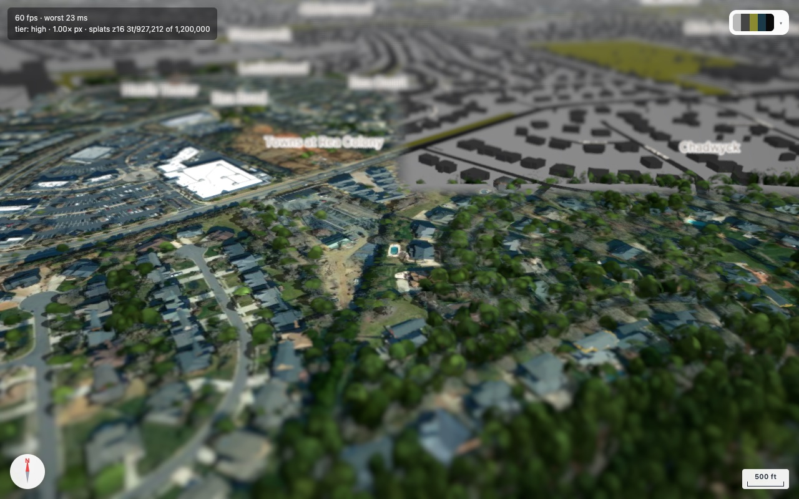
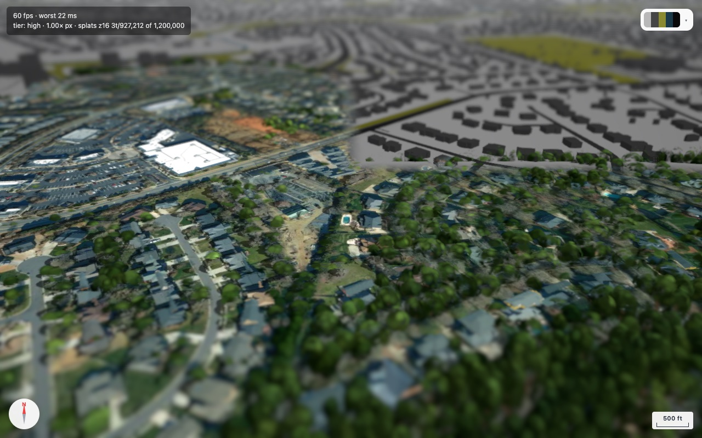
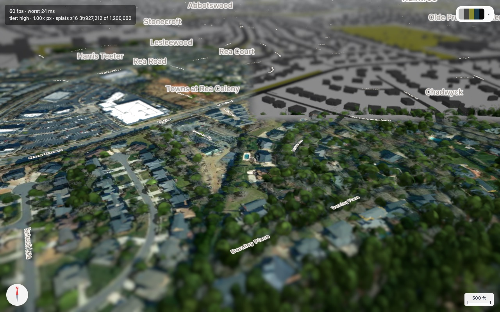

# Tilt-shift blurs the labels (open defect + failed fix, with the bisect)

## The defect

`setTiltShift(true)` runs a two-pass blur over the finished frame. The frame already contains the
LABELS, so place names go through the blur with everything else and come out unreadable. Compare
"Harris Teeter", "Towns at Rea Colony" and "Chadwyck" below:



Labels are UI, not scene. Blurring the geometry is the whole point of the effect; blurring the
names is a functional loss, and a map that cannot be read is not better than the alternatives. The
effect is otherwise good and costs nothing measurable (p95 20-21 ms with it on or off, two passes,
tilt 62, budget pinned at scale 1.00).

## The fix that should work, and does — visually

Hold the labels back from pass 1 (`camera.layers.disable(LABEL_THREE_LAYER)`), run the blur, then
draw the labels sharp on top. The first half is sound: with the label pass stubbed out, the effect
renders perfectly and the labels are cleanly absent from the blur — no ghosting, no haloes.



So the exclusion works. What does not work is drawing them back.

## What breaks

Adding the second render —

```ts
const labelMask = this.camera.layers.mask;
this.camera.layers.disableAll();
this.camera.layers.enable(LABEL_THREE_LAYER);
r.render(this.scene, this.camera);       // <- this
this.camera.layers.mask = labelMask;
```

— blanks the whole picture: the capture becomes a flat clear-colour grey with only sharp labels on
it. The BASEMAP disappears too, not just the splats, which is the important clue: the damage is not
to the label pass's own output but to **pass 1 of the following frame**, which ends up rendering an
empty scene that then gets blurred to flat grey.

Frame time stays a healthy p95 21 ms throughout, so nothing in the numbers hints at it — this was
only caught by looking at the picture.

## SOLVED — `scene.background` forces a clear that `autoClear: false` does not stop

three.js renders the scene background at the start of every `render()`. When `scene.background` is
a `Color` — which this map always sets, from the theme's sky colour — its background step sets
`forceClear = true`, and the resulting clear runs **regardless of `renderer.autoClear`**. So the
label pass was clearing the target to the sky colour and then drawing the labels onto it. One line,
a completely blank map.

The fix is to detach the background for the duration of that pass:

```ts
const bg = this.scene.background;
this.scene.background = null;     // <- or the render below clears the target to the sky colour
r.autoClear = false;
this.camera.layers.disableAll();
this.camera.layers.enable(LABEL_THREE_LAYER);
r.render(this.scene, this.camera);
this.scene.background = bg;
```

Result — effect intact, every label crisp, and street names that were previously smeared into
invisibility now readable. Cost is nil: p95 21-22 ms with the effect on versus 21 ms with it off.



### Why it took four bisections

Every observation was consistent with the real cause, and also with several wrong ones:

- *A second render with an unrestricted mask worked.* Not because the mask mattered — because that
  render redrew all the geometry **after** the clear, hiding it.
- *Layer mutation alone worked.* No render, so no background step, so no clear.
- *Pass 1 reported 265 draw calls and 463k triangles.* It really was drawing; the output was
  erased afterwards. This is the measurement that finally turned the search around, and it should
  have been the FIRST step rather than the fifth — instrument before theorising.
- *Removing the blur entirely still blanked it.* Which cleared the whole post chain of suspicion
  and left only the label pass itself.

## Ruled out along the way

Kept so none of these is retried; each was tested by building and looking at the picture.


Each of these was tested by building and looking at the picture, not by reasoning.

- **`renderer.autoClear`.** Defaults to true, so `render()` would wipe the blurred colour. Setting
  it false around the pass (and restoring) changed nothing.
- **Sharing the depth texture.** The first attempt attached the colour pass's `depthTexture` to the
  blur's second target so labels would still be occluded by terrain. One `DepthTexture` backing two
  framebuffers is not supported — a real bug — but removing it changed nothing, so not THIS bug.
- **The layer constant.** `LABEL_THREE_LAYER` is 1, not 0, so disabling it does not take the default
  layer with it.
- **Spark's `SparkRenderer`.** This was the prime suspect (its `onBeforeRender` does the splat sort).
  Loading the demo with NO `&splats=` at all — no SparkRenderer in the scene — still blanks. Dead.
- **`onBeforeRender` generally.** The only hook in the codebase is on building meshes
  (`BuildingsLayer`), and those are culled in the label-only pass, so it never runs.
- **The layer mutation on its own.** Doing `disableAll()` / `enable(LABEL)` / restore with NO second
  render renders perfectly. So mutating the mask is not what breaks it.
- **The second render on its own.** Issuing `r.render(scene, camera)` a second time with the mask
  UNCHANGED renders perfectly (the scene is drawn sharp over the blur, as expected). So a second
  traversal is not what breaks it either.
- **Culled lights.** The natural theory from the two facts above: with every layer disabled no light
  passes `light.layers.test(camera.layers)`, three.js rebuilds the scene's light state empty, and
  that state is cached per scene. Tested by enabling `LABEL_THREE_LAYER` on all four lights so they
  stay visible to the pass — still blank. Not the lights.
